# Lập trình robot FTC khi chưa có robot thật
## Motor & Cảm biến · Pedro Pathing · AprilTag · Flywheel Shooter
### Thực hành với **virtual_robot** + **Android Studio**, đi kèm sách *Learn Java for FTC* (Alan G. Smith)

> **Dành cho ai?** Học sinh, sinh viên và giáo viên/huấn luyện viên FTC đã học xong khoảng chương 1–12 của sách
> *Learn Java for FTC* (biến, if/while, lớp và phương thức, OpMode, phần cứng cơ bản, máy trạng thái).
> Mọi bài trong tài liệu chạy được hoàn toàn trên máy tính, **không cần robot thật**.
>
> **Đã kiểm chứng:** toàn bộ mã nguồn kèm theo được biên dịch trên một bản virtual_robot tải mới từ GitHub
> (tháng 10/2026, có Pedro Pathing v3) và chạy thử từng ví dụ, từng lời giải. Ảnh chụp màn hình, đồ thị và các con số
> trong tài liệu là kết quả chạy thật.

---

## Mục lục

- [Phần 0 — Chuẩn bị](#phần-0--chuẩn-bị)
  - [0.1 Bạn sẽ học gì](#01-bạn-sẽ-học-gì)
  - [0.2 Liên hệ với sách Learn Java for FTC](#02-liên-hệ-với-sách-learn-java-for-ftc)
  - [0.3 Cài đặt virtual_robot với Android Studio](#03-cài-đặt-virtual_robot-với-android-studio)
  - [0.4 Cài bộ mã nguồn kèm theo](#04-cài-bộ-mã-nguồn-kèm-theo)
  - [0.5 Làm quen giao diện virtual_robot](#05-làm-quen-giao-diện-virtual_robot)
  - [0.6 Mô phỏng khác robot thật ở đâu?](#06-mô-phỏng-khác-robot-thật-ở-đâu)
  - [0.7 Hệ tọa độ dùng trong tài liệu](#07-hệ-tọa-độ-dùng-trong-tài-liệu)
- [Phần 1 — Motor & Cảm biến](#phần-1--motor--cảm-biến)
  - [1.1 Lý thuyết](#11-lý-thuyết)
  - [1.2 Thực hành trên Programming Board (sách ch. 6–11)](#12-thực-hành-trên-programming-board-sách-ch-611)
  - [1.3 Thực hành trên MecDynamic Bot](#13-thực-hành-trên-mecdynamic-bot)
  - [1.4 Bài tập Phần 1](#14-bài-tập-phần-1)
- [Phần 2 — Pedro Pathing](#phần-2--pedro-pathing)
  - [2.1 Bài toán: đi tới đâu, bằng đường nào?](#21-bài-toán-đi-tới-đâu-bằng-đường-nào)
  - [2.2 Đường cong Bézier](#22-đường-cong-bézier)
  - [2.3 Nội suy hướng (heading interpolation)](#23-nội-suy-hướng-heading-interpolation)
  - [2.4 Follower bám đường như thế nào?](#24-follower-bám-đường-như-thế-nào)
  - [2.5 Bảng tra nhanh Pedro Pathing v3](#25-bảng-tra-nhanh-pedro-pathing-v3)
  - [2.6 Pedro Pathing trong virtual_robot](#26-pedro-pathing-trong-virtual_robot)
  - [2.7 Ví dụ](#27-ví-dụ)
  - [2.8 Bài tập Phần 2](#28-bài-tập-phần-2)
- [Phần 3 — AprilTag](#phần-3--apriltag)
  - [3.1 AprilTag là gì?](#31-apriltag-là-gì)
  - [3.2 ftcPose: thẻ nằm ở đâu so với camera?](#32-ftcpose-thẻ-nằm-ở-đâu-so-với-camera)
  - [3.3 AprilTag trên robot thật: VisionPortal](#33-apriltag-trên-robot-thật-visionportal)
  - [3.4 Camera giả lập trong virtual_robot](#34-camera-giả-lập-trong-virtual_robot)
  - [3.5 Ví dụ](#35-ví-dụ)
  - [3.6 Bài tập Phần 3](#36-bài-tập-phần-3)
- [Phần 4 — Flywheel Shooter](#phần-4--flywheel-shooter)
  - [4.1 Vật lý của flywheel](#41-vật-lý-của-flywheel)
  - [4.2 Bóng bay: ném xiên và bảng tra](#42-bóng-bay-ném-xiên-và-bảng-tra)
  - [4.3 Bốn cách điều khiển tốc độ flywheel](#43-bốn-cách-điều-khiển-tốc-độ-flywheel)
  - [4.4 Máy trạng thái bắn](#44-máy-trạng-thái-bắn)
  - [4.5 Luật chơi của Shooter Bot trong mô phỏng](#45-luật-chơi-của-shooter-bot-trong-mô-phỏng)
  - [4.6 Ví dụ](#46-ví-dụ)
  - [4.7 Bài tập Phần 4](#47-bài-tập-phần-4)
- [Phần 5 — Dự án tổng hợp: Autonomous DECODE](#phần-5--dự-án-tổng-hợp-autonomous-decode)
  - [5.1 Kịch bản](#51-kịch-bản)
  - [5.2 Những điểm đáng học trong code](#52-những-điểm-đáng-học-trong-code)
  - [5.3 Kết quả](#53-kết-quả)
  - [5.4 Thử thách mở rộng](#54-thử-thách-mở-rộng)
- [Phụ lục](#phụ-lục)
  - [A. Khắc phục sự cố thường gặp](#a-khắc-phục-sự-cố-thường-gặp)
  - [B. Tra cứu nhanh](#b-tra-cứu-nhanh)
  - [C. Từ mô phỏng sang robot thật: danh sách kiểm tra](#c-từ-mô-phỏng-sang-robot-thật-danh-sách-kiểm-tra)
  - [D. Nguồn tham khảo](#d-nguồn-tham-khảo)

---

# Phần 0 — Chuẩn bị

## 0.1 Bạn sẽ học gì

| Phần | Nội dung chính | Cấu hình robot trong virtual_robot |
|---|---|---|
| **1. Motor & Cảm biến** | encoder, đổi đơn vị, `RunMode`, servo, cảm biến chạm / biến trở / màu / khoảng cách, IMU, odometry Pinpoint, điều khiển P, máy trạng thái | Programming Board, MecDynamic Bot |
| **2. Pedro Pathing** | tư thế (pose), đường cong Bézier, nội suy hướng, thuật toán bám đường, Autonomous bằng máy trạng thái và bằng lệnh Ivy, Pedro trong TeleOp | MecDynamic Bot |
| **3. AprilTag** | thẻ AprilTag, ý nghĩa `ftcPose` (`range`, `bearing`, `yaw`...), đọc motif, tự ngắm, tự tiến tới thẻ, định vị lại robot | Shooter Bot + camera giả lập |
| **4. Flywheel Shooter** | vật lý bánh đà và quỹ đạo bóng, 4 cách điều khiển tốc độ (hở, PIDF có sẵn của Hub, feedforward + P, bang-bang), máy trạng thái bắn, bảng tra | Shooter Bot |
| **5. Dự án tổng hợp** | Autonomous DECODE: đọc motif → Pedro → ngắm bằng AprilTag → bắn 3 → nạp bóng → bắn 3 → về base | Shooter Bot |

**Một robot, một mục tiêu.** Bốn phần không phải bốn chủ đề rời nhau. Cả tài liệu xây dần **một** robot thi đấu và
hướng tới **một** chương trình: Autonomous DECODE ở Phần 5. Phần 1 dạy robot cảm nhận và điều khiển motor. Phần 2 cho
robot tự chạy theo đường vẽ sẵn. Phần 3 cho robot "nhìn" thẻ AprilTag để biết goal ở đâu và tự sửa vị trí. Phần 4 cho
robot bắn trúng ở mọi khoảng cách. Phần 5 ghép tất cả lại. Robot của Phần 3–5 là **Shooter Bot**: chính khung gầm
MecDynamic Bot của Phần 1–2, gắn thêm flywheel, intake và camera.

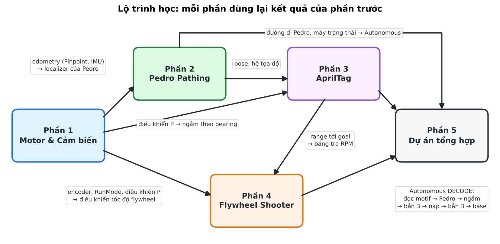

**Thứ tự học:** 1 → 2 → 3 → 4 → 5. Phần 4 dùng `range` của camera (Phần 3) để chọn tốc độ flywheel, nên hãy học
Phần 3 trước Phần 4. Mỗi phần đều có **lý thuyết → ví dụ chạy được → bài tập có lời giải**. Lời giải nằm trong khối thu
gọn *Lời giải*: hãy tự làm trước khi mở.

**Năm ý tưởng xuất hiện ở mọi phần.** Nhận ra chúng thì phần sau sẽ dễ hơn nhiều:

| Ý tưởng | Phần 1 | Phần 2 | Phần 3 | Phần 4 | Phần 5 |
|---|---|---|---|---|---|
| Vòng điều khiển "đọc cảm biến → tính sai số → ra lệnh" | điều khiển P theo encoder, IMU, khoảng cách | Pedro tự sửa lệch đường và sửa hướng | điều khiển P theo `bearing`, `range`, `yaw` | feedforward + P theo tốc độ flywheel | Pedro và flywheel cùng chạy trong mỗi vòng lặp |
| Máy trạng thái (`enum` + `switch`) | bài 1.6 | Autonomous DECODE | bài 3.4: TÌM → NGẮM | bắn: chờ đủ tốc → đẩy → rút về | 10 trạng thái, từ START tới base |
| Robot đang ở đâu? | encoder, IMU, Pinpoint | localizer của Pedro | định vị lại bằng thẻ goal | khoảng cách tới goal → RPM | định vị, ngắm, bắn trên cùng một hệ tọa độ |
| Đo thời gian bằng `ElapsedTime`, không chặn chương trình bằng `sleep()` dài | "ổn định 0,2 s" | chờ 1,5 s khi "bắn giả" | "ổn định 0,3 s", dung thứ rớt khung hình | servo 150 ms, "đủ tốc liên tục 100 ms" | mọi bước chờ đều có thời gian tối đa |
| Đổi đơn vị | tick → vòng → inch | inch, radian ↔ độ | inch, độ | tick/s ↔ RPM ↔ m/s | — |

> **Về sân thi đấu:** virtual_robot mặc định mở sân **BIOBUZZ** (mùa 2026–2027) với `NoGame` (không có vật cản). Tài
> liệu chuyển sang sân **DECODE (2025–2026)** vì virtual_robot có sẵn luật DECODE (goal là vật cản thật), FTC SDK có
> sẵn vị trí các thẻ AprilTag của mùa này, và mọi tọa độ ví dụ lấy theo sân DECODE. Kỹ năng trong tài liệu không phụ
> thuộc mùa giải. Sang mùa mới, bạn chỉ cần đổi tọa độ và ID thẻ, rồi đo lại bảng tra nếu robot vẫn phải bắn
> (Phụ lục C).

## 0.2 Liên hệ với sách *Learn Java for FTC*

Sách là nền tảng Java + FTC SDK. Tài liệu này nối tiếp sách theo hướng thi đấu. Số chương theo bản PDF ngày 11/05/2026.

| Chương trong sách | Dùng ở đâu trong tài liệu này |
|---|---|
| Ch. 6 *Our first hardware*: tách lớp **mechanism** (ProgrammingBoard) và **OpMode** | hai lớp mechanism `MecanumDrive` (Phần 1, 3, 4) và `Shooter` (Phần 4, 5) |
| Ch. 7 *Motors*: `DcMotor`, `RunMode`, encoder, `ZeroPowerBehavior` | 1.1, 1.2, Phần 4 (`getVelocity`, `setVelocity`) |
| Ch. 8 *Servos*, Ch. 9 *Analog Sensors*, Ch. 10 *Color and Distance Sensors*, Ch. 11 *Gyro (IMU)* | 1.1–1.3; servo đẩy bóng và cảm biến màu của ổ bóng ở Phần 4, 5 |
| Ch. 12 *Dealing with State*: `enum` + `switch` | bài 1.6, Autonomous ở Phần 2, máy trạng thái bắn ở Phần 4, Phần 5 |
| Ch. 16 *Computer Vision*: `AprilTagProcessor`, `VisionPortal` (16.1) | Phần 3 |
| Ch. 20 *Making Robots Drive*: mecanum, field-oriented | 1.3, TeleOp ở Phần 2, Phần 3 và Phần 4 |
| Ch. 21 *Some hardware to help with Odometry*: GoBILDA Pinpoint (21.3) | 1.3 (ví dụ 1.7), Phần 2 |
| Ch. 23 *Limelight 3A*: định vị bằng AprilTag (23.2) | Phần 3 (định vị lại) |
| Ch. 24 *Introduction to Control Theory*: bang-bang, P, PID(F), PIDF có sẵn | 1.1.5, 1.3, bài 1.3, bài 2.5, Phần 4 |
| Ch. 25 *Behavior Trees* | Phần 2 (lệnh Ivy cùng ý tưởng: ghép hành vi tuần tự/song song) |

> **Chú ý khi đọc sách:** trong *Listing 24.7 (BuiltInPIDOpMode)* sách viết `new PIDFCoefficients(kP, kD, kI, kF)`.
> Hàm tạo đúng của SDK là `PIDFCoefficients(p, i, d, f)` (thứ tự **P – I – D – F**). Hãy để ý khi chép code.

## 0.3 Cài đặt virtual_robot với Android Studio

virtual_robot là một ứng dụng **JavaFX** mô phỏng robot FTC nhìn từ trên xuống. Nó có một "bản sao gần đúng" của
FTC SDK (OpMode, `hardwareMap`, `DcMotor`, `Servo`, cảm biến, IMU, Pinpoint...) nên code viết cho mô phỏng gần như
giống hệt code cho robot thật.

1. **Cài JDK có sẵn JavaFX** — *Bell Liberica JDK 17 bản **Full*** (không phải bản Standard). Tải tại
   bell-sw.com → *JDK 17 LTS* → chọn hệ điều hành → **Package: Full JDK** → tải file `.msi` (Windows) hoặc `.dmg` (macOS).
   Hướng dẫn chi tiết có hình nằm trong file `Detailed Installation Instructions.pdf` của repo.
2. **Cài Android Studio** (hoặc IntelliJ IDEA Community — Android Studio được xây trên IntelliJ nên các bước giống nhau).
3. **Tải virtual_robot:** vào `https://github.com/Beta8397/virtual_robot` → nút **Code** → **Download ZIP** rồi giải nén.
   Cách khác là `git clone https://github.com/Beta8397/virtual_robot.git`.
4. **Mở project:** Android Studio → **File → Open** → chọn **thư mục virtual_robot bên trong cùng**. Đó là thư mục có
   `Controller`, `TeamCode`, `lib`. Đây là project kiểu IntelliJ, không phải Gradle. Nếu được hỏi *Trust project*, chọn Trust.
5. **Chọn JDK:** **File → Project Structure → Project → SDK** → chọn *Liberica 17 Full*. Nếu chưa có trong danh sách,
   bấm *Add SDK → JDK* và trỏ tới thư mục cài, ví dụ `C:\Program Files\BellSoft\LibericaJDK-17-Full`.
   Đặt **Language level = 17** → Apply → OK.
6. **Đặt mã hóa UTF-8** (bắt buộc vì code kèm theo có chú thích tiếng Việt): **File → Settings → Editor → File
   Encodings** → *Global Encoding* và *Project Encoding* = **UTF-8**.
7. **Chạy:** chọn cấu hình chạy **Main** ở thanh công cụ (lớp `virtual_robot.controller.VirtualRobotApplication`) rồi bấm
   ▶ (Run). Cửa sổ *Virtual Robot* hiện ra là thành công.

> **Màn hình laptop nhỏ?** Trong `Controller/src/virtual_robot/config/Config.java`, đổi `FIELD_WIDTH` từ 648 thành 576
> (hoặc 504, 432) **và** đổi tên ảnh sân cho khớp (ví dụ `decode576.bmp`).

## 0.4 Cài bộ mã nguồn kèm theo

Thư mục `code/` đi kèm tài liệu có cấu trúc **giống hệt** repo virtual_robot. Chép hai thư mục `code/Controller` và
`code/TeamCode` đè lên hai thư mục cùng tên của project (chỉ **thêm** file mới, không xóa gì của repo):

```
code/
├── Controller/src/virtual_robot/robots/classes/ShooterBot.java   ← cấu hình robot mới cho Phần 3–5
├── Controller/src/virtual_robot/robots/fxml/shooter_bot.fxml     ← hình dạng của Shooter Bot
└── TeamCode/src/org/firstinspires/ftc/teamcode/course/
    ├── sim/          SimTruth (vị trí thật), SimAprilTagCamera, SimTagDetection — chỉ dùng trong mô phỏng
    ├── mechanisms/   MecanumDrive (lái mecanum theo sách, ch. 20), Shooter (flywheel + servo đẩy)
    ├── util/         Pidf, TagLocalizer, InterpLUT, ShooterTable, ShooterPhysics, ColorUtil, MovingAverage
    ├── p1/ ... p5/   OpMode ví dụ của từng phần (nhóm "P1-MotorSensor", "P2-Pedro", "P3-AprilTag",
    │                 "P4-Flywheel", "P5-DuAn")
    └── solutions/    lời giải các bài tập lập trình (nhóm "Z-LoiGiai")
```

**Sửa `Controller/src/virtual_robot/config/Config.java`** để dùng sân DECODE:

```java
public static final Image BACKGROUND = new Image("/virtual_robot/assets/decode648.bmp"); // thay cho biobuzz648.bmp
public static final Game GAME = new Decode();                                           // thay cho new NoGame()
// (không bắt buộc) mở sẵn Shooter Bot thay cho Mecanum Bot:
// public static final Class<? extends VirtualBot> DEFAULT_BOT = virtual_robot.robots.classes.ShooterBot.class;
```

Chạy lại chương trình. Trong ô **Configurations** có thêm **Shooter Bot**. Trong ô **OpModes** có các OpMode `P1_...`
đến `P5_...` và `S..._` (lời giải).

> **Shooter Bot là gì?** Đây là cấu hình robot viết riêng cho tài liệu. Nó *kế thừa nguyên* MecDynamic Bot (khung gầm
> mecanum có mô hình vật lý, Pinpoint, IMU, 4 cảm biến khoảng cách, cảm biến màu nhìn sàn, tay gắp), nên hằng số Pedro
> Pathing có sẵn của virtual_robot vẫn dùng được: `P2_DecodeAutoBlue` của Phần 2 chạy trên Shooter Bot cũng xong sau
> khoảng 12 s, đúng đường đi như trên MecDynamic Bot. Bot thêm:
>
> | Tên trong `hardwareMap` | Loại | Ý nghĩa |
> |---|---|---|
> | `shooter_motor` | `DcMotorEx` | flywheel 1:1, 6000 RPM, **28 tick/vòng**, có quán tính, phụ thuộc điện áp pin, tụt tốc khi bắn |
> | `feeder_servo` | `Servo` | đẩy 1 bóng vào flywheel: `1` = đẩy, `0` = nghỉ; phải giữ **≥ 100 ms** ở mỗi vị trí |
> | `intake_motor` | `DcMotorEx` | hút bóng; chỉ nạp được khi tâm robot ở **vùng nạp** (ô 24 × 24 in ở 2 góc dưới), 0,4 s/bóng, tối đa 3 |
> | `ball_sensor` | `ColorSensor` + `DistanceSensor` | thấy màu quả bóng kế tiếp (tím/xanh lá); ~2,5 cm nếu có bóng, ~15 cm nếu trống |
> | `voltage_sensor` | `VoltageSensor` | điện áp pin mô phỏng: **ngẫu nhiên 12,0–13,6 V** mỗi lần chạy |
>
> Camera **không** nằm trong `hardwareMap`: Phần 3 giải thích vì sao và dùng lớp `SimAprilTagCamera` thay thế. Mỗi lần
> bắn, bot tính quỹ đạo bóng từ **tốc độ flywheel thật lúc bắn**, vẽ điểm bóng đi qua độ cao miệng goal lên sân và ghi
> **TRÚNG / NGẮN / DÀI / LỆCH TRÁI / LỆCH PHẢI / QUÁ YẾU** (luật chi tiết ở mục 4.5).

## 0.5 Làm quen giao diện virtual_robot

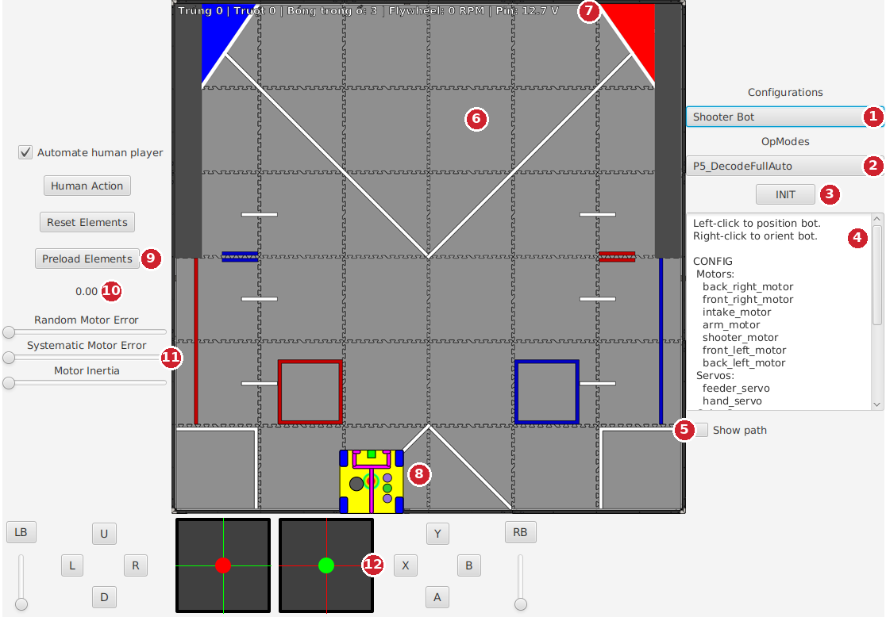

| Số | Thành phần | Dùng để |
|---|---|---|
| 1 | **Configurations** | chọn robot: *Programming Board* (Phần 1), *MecDynamic Bot* (Phần 1–2), *Shooter Bot* (Phần 3–5)... |
| 2 | **OpModes** | chọn OpMode (sắp xếp theo `group` trong `@TeleOp` / `@Autonomous`) |
| 3 | **INIT → START → STOP** | giống Driver Station: bấm 1 lần = INIT, lần 2 = START, lần 3 = STOP |
| 4 | Ô văn bản | trước INIT: danh sách thiết bị của cấu hình; sau INIT: **telemetry** |
| 5 | **Show path** | vẽ vệt đường robot đã đi (rất hữu ích với Pedro Pathing) |
| 6 | Sân | **trước khi INIT**: click chuột **trái** để đặt vị trí robot, click **phải** để xoay robot về phía điểm click |
| 7 | Dòng trạng thái của Shooter Bot | số phát trúng / trượt, số bóng trong ổ, RPM flywheel, điện áp pin |
| 8 | Robot | ô vuông xanh lá = mặt trước. Shooter Bot có thêm vòng tròn flywheel (đổi màu theo tốc độ) và 3 ô bóng |
| 9 | **Preload Elements** | nạp lại 3 bóng vào ổ của Shooter Bot (khi chưa INIT). Các nút khác của trò chơi DECODE như *Human Action* không dùng trong tài liệu |
| 10 | Đồng hồ | thời gian từ lúc START |
| 11 | Thanh trượt | thêm sai số ngẫu nhiên / sai số hệ thống / quán tính cho các motor "đơn giản" (Programming Board, Mecanum Bot) |
| 12 | Gamepad ảo | cần điều khiển kéo bằng chuột, các nút bấm bằng chuột (có thể dùng gamepad thật: `USE_VIRTUAL_GAMEPAD = false`) |

Sau mỗi lần STOP, Shooter Bot tự nạp lại đủ 3 bóng (2 tím + 1 xanh lá, thứ tự ngẫu nhiên) và "thay pin" với điện áp
ngẫu nhiên mới.

## 0.6 Mô phỏng khác robot thật ở đâu?

Biết trước các khác biệt giúp bạn không ngạc nhiên khi chuyển code sang robot thật:

| Chủ đề | Trong virtual_robot | Trên robot thật |
|---|---|---|
| `setMode(...)` | đặt lại công suất về 0 | thói quen tốt cho cả hai: luôn gọi `setMode` **trước** `setPower` |
| Motor "đơn giản" (`DcMotorExImpl`) | `RUN_USING_ENCODER` ≈ chạy hở; hệ số PIDF bị bỏ qua | Hub chạy bộ PIDF vận tốc thật |
| Motor khung gầm MecDynamic Bot / Shooter Bot | mô hình vật lý; **không** chịu ảnh hưởng 3 thanh trượt | có ma sát, trượt bánh, sụt pin |
| Flywheel của Shooter Bot | mô hình vật lý + bộ PIDF "kiểu Hub" **gần đúng** | phải tinh chỉnh lại hệ số |
| Servo | nhảy tới vị trí **ngay lập tức** | cần 0,1–0,25 s cho mỗi 60° |
| Cảm biến khoảng cách | chỉ thấy **tường sân**, chỉ khi lệch ≤ 7° so với vuông góc; tầm 5–100 cm, ngoài tầm trả về 820 cm | thấy mọi vật, nhiễu hơn |
| Cảm biến màu nhìn sàn | trung bình màu ảnh sân ngay dưới tâm robot | phụ thuộc ánh sáng, độ cao lắp |
| Pinpoint / odometry | **không trôi** (luôn đúng) | trôi dần theo thời gian, va chạm |
| Camera / AprilTag | `AprilTagProcessor.getDetections()` của virtual_robot **luôn trả về `null`** → dùng `SimAprilTagCamera` (mục 3.4) | webcam + `VisionPortal` |
| Gamepad | cần điều khiển có vùng chết 0,2 giống SDK; đẩy cần **lên** → `left_stick_y` **âm** | giống |
| `System.out.println` | hiện trong cửa sổ **Run** của Android Studio | dùng telemetry / log trên Robot Controller |

## 0.7 Hệ tọa độ dùng trong tài liệu

Cả năm phần dùng **một** hệ tọa độ, giống cách Pedro Pathing đặt tọa độ và giống hình nhìn trên màn hình virtual_robot:

- Gốc **(0, 0)** ở **góc dưới-trái** sân; **x** sang phải, **y** lên trên; đơn vị **inch**. Sân rộng 144 × 144 in,
  mỗi ô thảm 24 in.
- **Heading** (hướng robot): **0°** = robot nhìn sang phải (+x), **90°** = nhìn lên trên, góc tăng theo chiều
  **ngược kim đồng hồ**. Trong code, Pedro dùng **radian**; `PoseFactory.degrees()` cho phép bạn viết bằng độ.

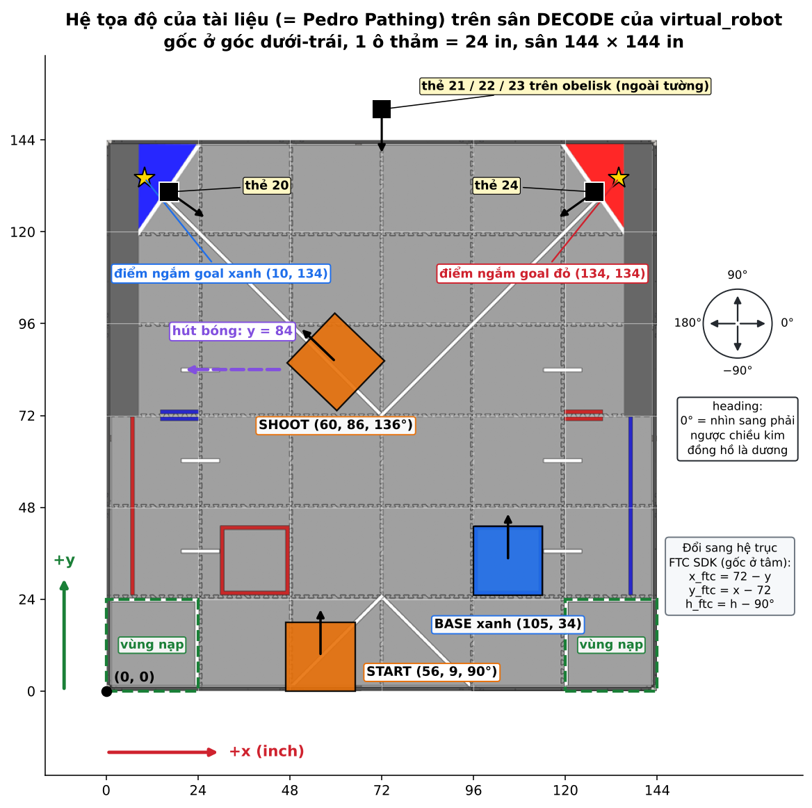

**Vì sao cần quy ước?** Cùng một vị trí có thể viết bằng nhiều hệ trục. Hệ tọa độ sân chính thức của FTC SDK (dùng cho
thư viện thẻ AprilTag và `robotPose` ở Phần 3) đặt gốc ở **tâm sân**. Công thức đổi ghi ở góc phải hình. Ví dụ điểm ngắm
goal xanh (10, 134) trong tài liệu ứng với (72 − 134; 10 − 72) = (−62; −62) trong hệ SDK. Ngược lại, thẻ 20 trong SDK
nằm ở (−58,4; −55,6) thì trong tài liệu là (−55,6 + 72; 72 − (−58,4)) = (16,4; 130,4).

> **Đặt robot đúng chỗ trong mô phỏng:** trước khi bấm INIT, click trái vào vị trí xuất phát. Dùng các đường ranh ô
> thảm: mỗi ô 24 in, ví dụ (24, 24) là giao điểm ô thứ nhất tính từ góc dưới-trái. Sau đó click phải phía trên robot để
> robot nhìn lên (90°). Nhiều OpMode kèm theo hiển thị "vị trí thật" của robot trong lúc INIT để bạn kiểm tra.
> Vị trí thật lấy từ lớp `SimTruth`, chỉ có trong mô phỏng.

---

# Phần 1 — Motor & Cảm biến

> **Mục tiêu:** đọc/điều khiển motor bằng encoder, đổi đơn vị chính xác, dùng servo và các loại cảm biến,
> viết vòng lặp điều khiển P "đọc cảm biến → tính sai số → ra lệnh".
> **Cấu hình:** *Programming Board* (giống board trong sách) và *MecDynamic Bot*.
> **Sách:** ch. 6–12, 20, 21, 24.
> **Dùng lại ở:** Phần 2 (Pinpoint là localizer của Pedro), Phần 3 (điều khiển P theo góc tới thẻ), Phần 4 (encoder,
> `getVelocity`, đổi tick/s ↔ RPM, servo đẩy bóng, điều khiển tốc độ).

## 1.1 Lý thuyết

### 1.1.1 Motor DC, hộp số và encoder

Motor DC quay nhanh khi được cấp điện áp lớn. Hộp số đổi **tốc độ** lấy **lực**: tỉ số 19,2:1 nghĩa là trục motor quay
19,2 vòng thì trục ra quay 1 vòng. Trục ra chậm hơn 19,2 lần nhưng mạnh hơn gần 19,2 lần. **Encoder** gắn trên trục
motor phát ra xung (*tick*) khi quay. Đếm tick cho biết motor đã quay bao nhiêu, đếm tick mỗi giây cho biết tốc độ.

| Motor (thực tế) | Tick / vòng trục ra | Tốc độ không tải | Trong virtual_robot |
|---|---|---|---|
| goBILDA 5203, 1:1 | 28 | 6000 RPM | `MotorType.RevUltraPlanetaryOneToOne` (28) |
| goBILDA 5203, 13,7:1 | 384,5 | 435 RPM | `MotorType.Gobilda137` (383,6) |
| goBILDA 5203, 19,2:1 | 537,7 | 312 RPM | `MotorType.Gobilda192` (537,6) — 4 bánh của *MecDynamic Bot* |
| REV HD Hex 40:1 / NeveRest 40 | 1120 | ~150 RPM | `MotorType.Neverest40` — motor của *Programming Board*, `arm_motor` của *MecDynamic Bot* |

**Các công thức đổi đơn vị** (dùng suốt tài liệu):

| Muốn tính | Công thức |
|---|---|
| số vòng | `vòng = tick / (tick/vòng)` |
| góc (độ) | `độ = tick / (tick/vòng) × 360` |
| quãng đường bánh xe | `inch = vòng × π × đường kính` → `tick/inch = (tick/vòng) / (π × D)` |
| tốc độ quay | `RPM = (tick/giây) / (tick/vòng) × 60` và ngược lại `tick/giây = RPM × (tick/vòng) / 60` |
| tốc độ dài của bánh | `inch/giây = RPM / 60 × π × D` |

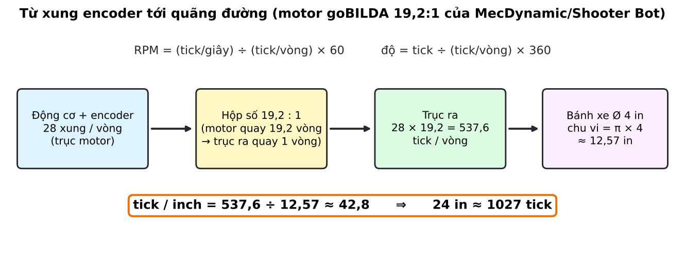

> ⚠️ **Bẫy chia số nguyên** (sách, ch. 7.4): `int / int` trong Java cho ra `int`. `getCurrentPosition() / 1120` sẽ cắt mất
> phần lẻ. Hãy lưu `tick/vòng` trong biến kiểu `double`.

### 1.1.2 `DcMotor` và `DcMotorEx`

```java
DcMotorEx motor = hardwareMap.get(DcMotorEx.class, "motor");   // DcMotorEx = DcMotor + vận tốc, PIDF...
motor.setDirection(DcMotorSimple.Direction.REVERSE);            // đảo chiều "tiến" (thường dùng cho bánh bên trái)
motor.setZeroPowerBehavior(DcMotor.ZeroPowerBehavior.BRAKE);    // công suất 0 => phanh (FLOAT = thả trôi)
motor.setMode(DcMotor.RunMode.STOP_AND_RESET_ENCODER);          // đưa encoder về 0
motor.setMode(DcMotor.RunMode.RUN_USING_ENCODER);
motor.setPower(0.5);                                            // -1 .. 1
int ticks = motor.getCurrentPosition();                         // vị trí (tick)
double tps = motor.getVelocity();                               // vận tốc (tick/giây) — chỉ có ở DcMotorEx
```

| `RunMode` | `setPower(p)` nghĩa là | Ghi chú |
|---|---|---|
| `RUN_WITHOUT_ENCODER` | cấp `p` × điện áp pin (điều khiển **hở**) | tên dễ hiểu nhầm: encoder **vẫn đếm**, chỉ là không dùng để điều khiển |
| `RUN_USING_ENCODER` | chạy ở vận tốc `p` × vận tốc tối đa (Hub tự điều chỉnh) | dùng với `setVelocity(tick/s)` khi cần giữ tốc độ ổn định dù tải thay đổi (flywheel, Phần 4) |
| `RUN_TO_POSITION` | chạy tới `setTargetPosition(...)` với tốc độ tối đa `p` | **phải** `setTargetPosition` **trước** khi đổi sang chế độ này, nếu không sẽ báo lỗi |
| `STOP_AND_RESET_ENCODER` | motor dừng, encoder về 0 | sau đó đổi lại sang chế độ khác |

> Sách khuyên **không** dùng `RUN_TO_POSITION` cho khung gầm (4 bánh tự chạy tới đích riêng → robot "lắc"). Với khung
> gầm, ta tự viết vòng điều khiển (mục 1.3) hoặc dùng Pedro Pathing (Phần 2).

### 1.1.3 Servo

`servo.setPosition(x)` với `x` từ 0 đến 1 đưa servo tới một góc trong khoảng hoạt động. `scaleRange(min, max)` thu hẹp
khoảng đó, `setDirection(REVERSE)` đảo chiều. `CRServo` là servo quay liên tục, điều khiển bằng `setPower`.
**Trong mô phỏng servo nhảy tới vị trí ngay lập tức.** Servo thật cần khoảng 0,1–0,25 s cho mỗi 60°, nên code thật phải
**chờ** servo tới nơi trước bước tiếp theo, ví dụ đo 150–300 ms bằng `ElapsedTime` (không dùng `sleep()` trong `loop()`).
Servo đẩy bóng của Shooter Bot ở Phần 4 làm đúng như vậy: giữ 150 ms ở mỗi vị trí.

### 1.1.4 Các cảm biến hay dùng

| Cảm biến | Lớp SDK | Đọc giá trị | Lưu ý |
|---|---|---|---|
| Nút chạm (digital) | `DigitalChannel` / `TouchSensor` | `getState()` / `isPressed()` | với `DigitalChannel` của REV: **`false` = đang nhấn** |
| Biến trở (analog) | `AnalogInput` | `getVoltage()` (0…`getMaxVoltage()`) | đổi sang góc: `Range.scale(v, 0, vMax, 0, 270)` |
| Màu | `ColorSensor` | `red()`, `green()`, `blue()` | phân loại màu bằng **sắc độ (hue)** bền hơn so sánh R, G, B |
| Khoảng cách | `DistanceSensor` | `getDistance(DistanceUnit.CM)` | có tầm đo tối thiểu/tối đa; ngoài tầm trả về số rất lớn |
| IMU (con quay) | `IMU` | `getRobotYawPitchRollAngles().getYaw(AngleUnit.DEGREES)` | yaw trong (−180°, 180°]; **ngược chiều kim đồng hồ = dương** |
| Odometry | `GoBildaPinpointDriver` | `update()` rồi `getPosition()` | phải gọi `update()` **mỗi vòng lặp** |

**Vì sao dùng hue?** Bóng tím dưới đèn mạnh có thể là (150, 50, 220), dưới đèn yếu là (75, 25, 110). R, G, B thay đổi
gấp đôi nhưng **sắc độ vẫn ≈ 275°**. Đổi bằng `android.graphics.Color.RGBToHSV(r, g, b, hsv)`. Kết quả: `hsv[0]` = sắc độ
0–360°, `hsv[1]` = độ bão hòa, `hsv[2]` = độ sáng. Lớp `ColorUtil` ở Phần 4–5 dùng đúng cách này để phân biệt bóng tím
và bóng xanh lá trong ổ của Shooter Bot.

### 1.1.5 Vòng lặp điều khiển và điều khiển P

Mọi chương trình robot đều lặp lại 3 bước: **đọc cảm biến → tính sai số → ra lệnh**.

```
sai_số = mục_tiêu − giá_trị_đo
lệnh   = kP × sai_số            (điều khiển tỉ lệ — sách ch. 24.4)
```

- `kP` **quá nhỏ** → chậm, có thể **không tới đích** vì công suất nhỏ không thắng nổi ma sát.
- `kP` **vừa** → nhanh, không vọt lố.
- `kP` **lớn** → nhanh hơn nhưng **vọt lố**, rồi dao động quanh đích.

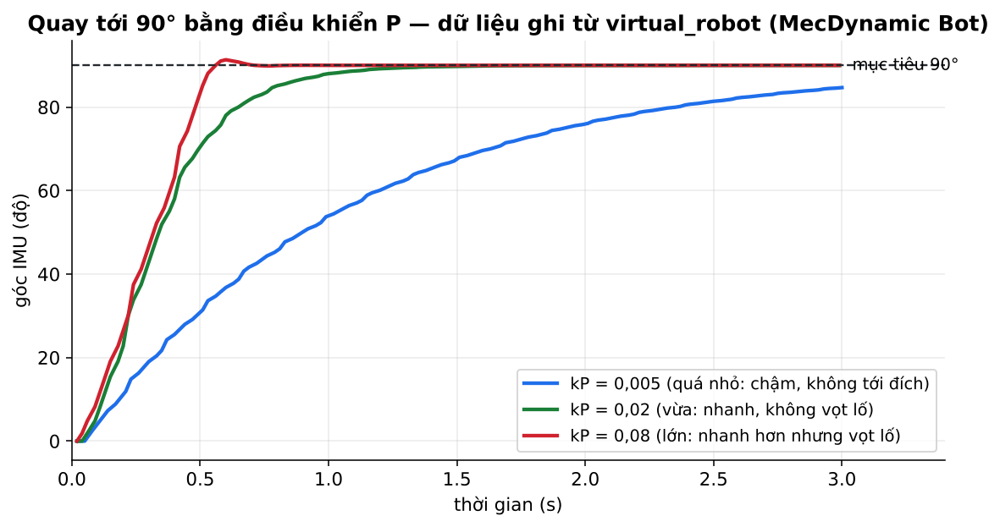

Ba "mẹo" luôn đi kèm điều khiển P trên robot:

1. **Công suất tối thiểu** (`MIN_POWER`): khi gần đích, `kP × sai số` quá nhỏ để thắng ma sát tĩnh → kẹp tối thiểu ~0,06.
2. **Dung sai + thời gian ổn định**: coi là "tới đích" khi `|sai số| < dung sai` **liên tục** trong ~0,2 s, không chỉ một lần.
3. **Chuẩn hóa góc**: sai số góc phải nằm trong (−180°, 180°]. Đi từ 170° tới −170° chỉ cần quay **20°**, không phải
   340°. Dùng `AngleUnit.normalizeDegrees(...)`.

Vòng lặp này sẽ gặp lại ở mọi phần sau, chỉ khác "cảm biến" và "lệnh": Pedro Pathing tự sửa lệch đường (Phần 2), robot
quay cho thẻ AprilTag về giữa ảnh (Phần 3), flywheel giữ đúng tốc độ (Phần 4).

## 1.2 Thực hành trên Programming Board (sách ch. 6–11)

Chọn cấu hình **Programming Board**. Board có `motor` (NeveRest 40), `servo`, `touch_sensor`, `pot`, cảm biến màu +
khoảng cách `sensor_color_distance` và `imu`. Trên board có các thanh trượt để "giả" giá trị cảm biến: kéo POT, kéo
R, G, B, kéo D (khoảng cách), bấm nút TO… (touch). Kéo chuột trên board để xoay nó (thay đổi IMU).

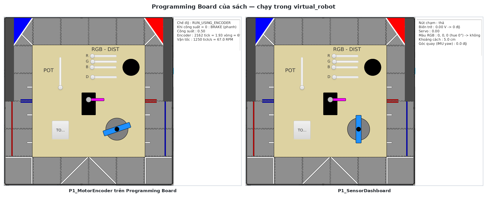

### Ví dụ 1.1 — `P1_MotorEncoder`: motor, encoder, RUN_TO_POSITION

File `course/p1/P1_MotorEncoder.java`. Điều khiển: cần trái = công suất, **A** = reset encoder, **B** = BRAKE/FLOAT,
**dpad ↑/↓** = quay thêm đúng ±1 vòng. Phần quan trọng nhất là thứ tự lệnh của `RUN_TO_POSITION`:

```java
if (gamepad1.dpadUpWasPressed() || gamepad1.dpadDownWasPressed()) {
    int delta = (int) Math.round(gamepad1.dpad_up ? ticksPerRev : -ticksPerRev);
    motor.setTargetPosition(motor.getCurrentPosition() + delta);   // 1) đặt mục tiêu
    motor.setMode(DcMotor.RunMode.RUN_TO_POSITION);                // 2) đổi chế độ
    motor.setPower(0.5);                                           // 3) công suất tối đa khi chạy tới đích
}
if (motor.getMode() == DcMotor.RunMode.RUN_TO_POSITION) {
    if (!motor.isBusy()) motor.setMode(DcMotor.RunMode.RUN_USING_ENCODER);  // tới nơi => trả quyền cho cần điều khiển
} else {
    motor.setPower(-gamepad1.left_stick_y);                        // đẩy cần LÊN => left_stick_y ÂM
}
double rpm = motor.getVelocity() / ticksPerRev * 60.0;              // tick/s -> RPM
```

**Thử:** đẩy cần ~60% → telemetry hiện khoảng *1250 tick/s ≈ 67 RPM*. Kéo thanh **Motor Inertia** sang phải, thả cần
điều khiển và so sánh BRAKE (dừng ngay) với FLOAT (quay trôi một lúc).

### Ví dụ 1.2 — `P1_SensorDashboard`: tất cả cảm biến của board

Servo đi theo biến trở (vòng lặp đọc → điều khiển đơn giản nhất), màu được phân loại theo hue:

```java
boolean pressed = !touch.getState();                         // DigitalChannel: false = đang nhấn
double potAngle = Range.scale(pot.getVoltage(), 0, pot.getMaxVoltage(), 0, 270);
servo.setPosition(potAngle / 270.0);                         // servo bám theo biến trở

float[] hsv = new float[3];
Color.RGBToHSV(color.red(), color.green(), color.blue(), hsv);
telemetry.addData("Màu", tenMau(hsv));                        // ĐỎ / VÀNG / XANH LÁ / XANH DƯƠNG / TÍM
telemetry.addData("Khoảng cách", "%.1f cm", distance.getDistance(DistanceUnit.CM));
telemetry.addData("IMU yaw", "%.1f độ", imu.getRobotYawPitchRollAngles().getYaw(AngleUnit.DEGREES));
```

> Cảm biến màu và cảm biến khoảng cách của REV Color Sensor V3 dùng **chung một tên** trong cấu hình
> (`sensor_color_distance`). Lấy ra 2 lần với 2 kiểu khác nhau (sách ch. 10).

## 1.3 Thực hành trên MecDynamic Bot

Chọn cấu hình **MecDynamic Bot**. Bốn motor bánh tên `front_left_motor`,
`front_right_motor`, `back_left_motor`, `back_right_motor` (goBILDA 19,2:1, bánh 4 in). Robot có thêm `imu`,
`color_sensor` (nhìn xuống sàn), `front_distance` / `left_distance` / `right_distance` / `back_distance` và `pinpoint`.
Các ví dụ dùng lớp `MecanumDrive` giống chương 20 của sách: `drive(forward, right, rotate)`.

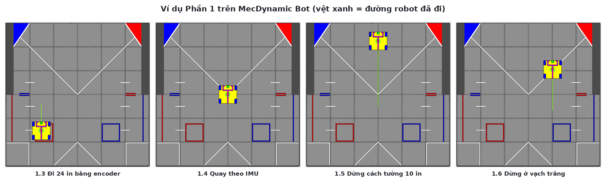

### Ví dụ 1.3 — `P1_DriveDistance`: đi đúng 24 in bằng encoder

Đặt robot ở (36, 36) nhìn lên. Hệ số `tick/inch = 537,6 / (π × 4) ≈ 42,8`:

```java
static final double TICKS_PER_INCH = 537.6 / (Math.PI * 4.0);
...
double target = inches * TICKS_PER_INCH;
while (opModeIsActive()) {
    double error = target - drive.averageForwardTicks();
    if (Math.abs(error) < TOLERANCE_TICKS) break;
    double power = KP * error;                                               // điều khiển P
    power = Math.signum(power) * Math.max(MIN_POWER, Math.min(MAX_POWER, Math.abs(power)));
    drive.drive(power, 0, 0);
}
drive.stop();
```

**Kết quả trong mô phỏng:** encoder báo khoảng 25,6 in, quãng đường thật (đo bằng `SimTruth`) cũng khoảng 25,6 in.
Encoder **đếm đúng**, nhưng robot **vượt đích ~1,6 in**. Lý do: vòng lặp dừng khi sai số < 10 tick, lúc đó robot vẫn
đang chạy nhanh, nên quán tính đẩy nó đi tiếp. Cách sửa là *Bài tập 1.3*.

### Ví dụ 1.4 — `P1_TurnToHeading`: quay theo IMU

```java
double heading = imu.getRobotYawPitchRollAngles().getYaw(AngleUnit.DEGREES);
double error = AngleUnit.normalizeDegrees(targetDeg - heading);     // luôn trong (-180, 180]
double turn = KP * error;
turn = Math.signum(turn) * Math.max(MIN_TURN, Math.min(MAX_TURN, Math.abs(turn)));
drive.drive(0, 0, -turn);   // IMU: dương = quay TRÁI; MecanumDrive của sách: rotate dương = quay PHẢI => dấu trừ
```

Robot quay lần lượt tới 90°, 180°, −90°, 0° (so với hướng lúc bắt đầu), mỗi lần sai số dưới 1°.

### Ví dụ 1.5 — `P1_StopAtWall`: dừng cách tường 10 in

Cảm biến khoảng cách chỉ đo được trong khoảng 5–100 cm. Khi chưa thấy tường (giá trị > 300 in), cho robot chạy tốc độ
vừa phải. Khi tường đã vào tầm, dùng điều khiển P theo `khoảng cách − 10`. Đặt robot ở (72, 60) nhìn lên → robot dừng
cách tường trên ~9,7–10 in.

### Ví dụ 1.6 — `P1_FindLine`: tìm vạch trắng bằng cảm biến màu

Thay vì đặt ngưỡng cố định, OpMode **hiệu chuẩn** độ sáng nền trong lúc INIT. Robot dừng khi độ sáng vượt nền một
khoảng `JUMP`. Đặt robot ở (96, 56) nhìn lên → robot dừng đúng trên vạch chéo trắng của vùng bắn (nền ≈ 122, vạch ≈ 149).

```java
while (opModeInInit()) background = (color.red() + color.green() + color.blue()) / 3.0;   // hiệu chuẩn
...
boolean onLine = brightness > background + JUMP;
```

### Ví dụ 1.7 — `P1_Odometry`: GoBILDA Pinpoint (sách ch. 21.3)

Lái robot bằng gamepad. Telemetry so sánh vị trí do Pinpoint tính với vị trí thật. Trong mô phỏng hai giá trị khớp
nhau hoàn toàn vì Pinpoint mô phỏng không trôi. Trên robot thật, odometry trôi dần sau va chạm và trượt bánh; Phần 3 sẽ
sửa lại bằng thẻ AprilTag. **Nhớ gọi `pinpoint.update()` mỗi vòng lặp.** Nếu không, bạn sẽ đọc mãi một vị trí cũ.

```java
pinpoint.setPosition(new Pose2D(DistanceUnit.INCH, x, y, AngleUnit.DEGREES, h));   // đặt hệ tọa độ sân
...
pinpoint.update();
Pose2D p = pinpoint.getPosition();
```

## 1.4 Bài tập Phần 1

Độ khó: ★ cơ bản · ★★ trung bình · ★★★ nâng cao. Hãy tự làm trước khi mở lời giải.

**Bài 1.1 (★) — Đổi đơn vị.**
a) Motor NeveRest 40 (1120 tick/vòng) đọc được 2800 tick. Trục đã quay bao nhiêu vòng, bao nhiêu độ?
b) Khung gầm goBILDA 19,2:1 (537,6 tick/vòng), bánh Ø 4 in. Muốn đi 36 in thì cần bao nhiêu tick?
c) Motor NeveRest 40 có `getVelocity()` = 1250 tick/s. Đổi ra RPM.
d) Motor 1:1 (28 tick/vòng) cần quay 2200 RPM ở chế độ `RUN_USING_ENCODER`. Truyền vào `setVelocity(...)` giá trị bao nhiêu?
   (Đây chính là motor flywheel của Phần 4.)
e) Bánh Ø 4 in quay 312 RPM thì robot chạy được bao nhiêu inch/giây?

<details>
<summary>Lời giải 1.1</summary>

a) 2800 / 1120 = **2,5 vòng** = 2,5 × 360 = **900°**.
b) tick/inch = 537,6 / (π × 4) = 537,6 / 12,566 ≈ **42,78** → 36 in × 42,78 ≈ **1540 tick**.
c) 1250 / 1120 × 60 ≈ **67 RPM** (đúng bằng số telemetry hiện ở ví dụ 1.1).
d) 2200 × 28 / 60 ≈ **1026,7 tick/s** → `setVelocity(1026.7)`.
e) 312 / 60 × π × 4 ≈ **65,3 in/s** (≈ 1,66 m/s) — đây là tốc độ lý thuyết, thực tế thấp hơn vì tải và ma sát.

</details>

**Bài 1.2 (★) — Quay đúng 90°.** Sửa `P1_MotorEncoder`: bấm **X** thì motor của board quay thêm đúng 90°.

<details>
<summary>Lời giải 1.2</summary>

90° = ¼ vòng = 1120 / 4 = 280 tick. Thêm vào `loop()`, ngay dưới khối dpad:

```java
if (gamepad1.xWasPressed()) {
    motor.setTargetPosition(motor.getCurrentPosition() + (int) Math.round(ticksPerRev / 4));
    motor.setMode(DcMotor.RunMode.RUN_TO_POSITION);
    motor.setPower(0.4);
}
```

Phần `if (!motor.isBusy()) ...` có sẵn sẽ tự trả quyền cho cần điều khiển khi motor tới đích.

Chạy thử trong mô phỏng: mỗi lần bấm X, encoder tăng **275 tick (≈ 88°)**, không phải đúng 280. `isBusy()` trả về
`false` khi motor đã gần đích (sai số vài tick) và gần như dừng. Code lập tức chuyển về `RUN_USING_ENCODER` với công
suất 0, nên motor dừng luôn ở đó. Muốn chính xác hơn, hãy giữ `RUN_TO_POSITION` cho tới khi người lái đụng vào cần
điều khiển. Trên robot thật, dung sai này chỉnh được bằng `setTargetPositionTolerance(...)`.

</details>

**Bài 1.3 (★★) — Không vượt đích.** `P1_DriveDistance` vượt đích ~1,6 in. Hãy sửa để robot dừng trong ±0,3 in.
*Gợi ý:* (1) chỉ kết thúc khi sai số nhỏ **và** robot gần như đứng yên trong 200 ms; (2) giới hạn tốc độ theo quãng
đường còn lại: muốn dừng kịp với gia tốc hãm `a` thì tốc độ hiện tại không được vượt `√(2·a·d)`.

<details>
<summary>Lời giải 1.3 — <code>solutions/S1_3_DriveNoOvershoot.java</code></summary>

```java
double error = target - drive.averageForwardTicks();
double speedInPerS = Math.abs(fl.getVelocity()) / TICKS_PER_INCH;     // fl = motor trước-trái (DcMotorEx)
boolean close = Math.abs(error) < 8 && speedInPerS < 1.0;
if (!close) settled.reset();
if (settled.milliseconds() > 200) break;                             // gần đích VÀ đứng yên 0,2 s

double remainingIn = Math.abs(error) / TICKS_PER_INCH;
double vLimit = Math.sqrt(2 * DECEL_IN_PER_S2 * remainingIn);        // tốc độ tối đa còn kịp hãm
double powerLimit = Math.min(MAX_POWER, vLimit / MAX_SPEED_IN_PER_S);
double power = Math.max(-powerLimit, Math.min(powerLimit, KP * error));
if (Math.abs(error) >= 8 && Math.abs(power) < MIN_POWER) power = Math.signum(error) * MIN_POWER;
if (Math.abs(error) < 8) power = 0;
drive.drive(power, 0, 0);
```

Kết quả trong mô phỏng: **24,07 in** cho cả chiều đi và chiều về (trước khi sửa là 25,6 in). Giới hạn `√(2ad)` chính là
ý tưởng "hồ sơ vận tốc hình thang" mà Pedro Pathing và Road Runner dùng ở mức cao hơn.

</details>

**Bài 1.4 (★) — Servo chỉ màu.** Trên Programming Board, kéo các thanh R, G, B. Cho servo về 0 nếu màu là ĐỎ, 0,5 nếu
XANH LÁ, 1 nếu XANH DƯƠNG, giữ nguyên nếu không rõ màu.

<details>
<summary>Lời giải 1.4</summary>

Dùng lại hàm `tenMau(hsv)` của `P1_SensorDashboard`:

```java
String mau = tenMau(hsv);
switch (mau) {
    case "ĐỎ":         servo.setPosition(0.0); break;
    case "XANH LÁ":    servo.setPosition(0.5); break;
    case "XANH DƯƠNG": servo.setPosition(1.0); break;
    default:           break;            // không rõ màu => giữ nguyên vị trí cũ
}
```

Nhớ bỏ dòng `servo.setPosition(potAngle / 270.0)`, để mỗi vòng lặp servo chỉ nhận **một** lệnh. Đây cũng là lý do
sách dùng `if / else if / else` khi điều khiển servo (ch. 8.3).

</details>

**Bài 1.5 (★★) — Chạy dọc tường.** Đặt MecDynamic Bot ở (30, 30) nhìn sang **phải** (0°). Viết OpMode cho robot tiến
và giữ tường ở bên **phải robot** cách 12 in (dùng `right_distance` để điều khiển chạy ngang). Robot dừng khi
`front_distance` < 10 in.

<details>
<summary>Lời giải 1.5 — <code>solutions/S1_5_WallFollow.java</code></summary>

```java
while (opModeIsActive()) {
    double r = right.getDistance(DistanceUnit.INCH);
    double f = front.getDistance(DistanceUnit.INCH);
    if (f < 300 && f < 10) break;                                     // tường trước đã gần
    double side = 0;
    if (r < 300) side = Math.max(-0.3, Math.min(0.3, KP_SIDE * (r - WALL_IN)));   // xa tường => sang phải
    drive.drive(FORWARD, side, 0);
}
drive.stop();
```

Robot giữ đúng 12,0 in cách tường dưới và dừng ở 10,1 in trước tường phải. Vì sao không chạy dọc tường trái/phải của
sân? Ở nửa trên sân có **ramp** và **goal**: đó là vật cản thật, nhưng cảm biến khoảng cách mô phỏng không "thấy" chúng
(chỉ thấy tường). Đây là bài học thực tế: luôn biết cảm biến của bạn đo **cái gì**.

</details>

**Bài 1.6 (★★★) — Máy trạng thái 3 cảm biến.** Từ (96, 56) nhìn lên: chạy tới vạch trắng (cảm biến màu) → quay trái
90° (IMU) → chạy tới cách tường 10 in (cảm biến khoảng cách) → dừng. Viết bằng `enum` + `switch` trong `OpMode` lặp
(sách ch. 12), **không** dùng `while` bên trong `loop()`.

<details>
<summary>Lời giải 1.6 — <code>solutions/S1_6_LineTurnWall.java</code></summary>

```java
enum State {FIND_LINE, TURN_LEFT, TO_WALL, DONE}
...
public void loop() {
    switch (state) {
        case FIND_LINE: {
            double brightness = (color.red() + color.green() + color.blue()) / 3.0;
            if (brightness > background + 15) {
                drive.stop();
                turnTarget = AngleUnit.normalizeDegrees(heading() + 90);    // quay TRÁI 90°
                state = State.TURN_LEFT;
            } else drive.drive(0.25, 0, 0);
            break;
        }
        case TURN_LEFT: {
            double error = AngleUnit.normalizeDegrees(turnTarget - heading());
            if (Math.abs(error) < 1.0) { drive.stop(); state = State.TO_WALL; }
            else drive.drive(0, 0, -Math.signum(error) * Math.max(0.06, Math.min(0.4, Math.abs(0.02 * error))));
            break;
        }
        case TO_WALL: {
            double d = front.getDistance(DistanceUnit.INCH);
            double err = (d > 300 ? 100 : d) - 10;
            if (Math.abs(err) < 0.3) { drive.stop(); state = State.DONE; }
            else drive.drive(Math.max(-0.5, Math.min(0.5, 0.05 * err)), 0, 0);
            break;
        }
        case DONE: drive.stop(); break;
    }
    telemetry.addData("Trạng thái", state);
}
```

Mỗi `case` chỉ làm **một bước nhỏ** rồi thoát. `loop()` được gọi lại sau ~20 ms, nhờ đó telemetry và nút STOP luôn
phản hồi. Đây là ưu điểm của OpMode lặp mà sách nhắc ở Phụ lục B.

</details>

---

# Phần 2 — Pedro Pathing

> **Mục tiêu:** hiểu *pose*, đường cong Bézier, nội suy hướng và cách Pedro Pathing bám đường. Viết Autonomous bằng
> máy trạng thái và bằng lệnh Ivy, dùng Pedro trong TeleOp.
> **Cấu hình:** **MecDynamic Bot**. Hằng số Pedro trong virtual_robot được tinh chỉnh cho khung gầm này. Shooter Bot
> (Phần 3–5) kế thừa nguyên khung gầm nên cũng chạy tốt. Các cấu hình khác sẽ chạy kém.
> **Sách:** ch. 12 (máy trạng thái), ch. 20, ch. 21, ch. 25.
> **Dựa trên:** Phần 1 (Pinpoint, IMU, điều khiển P, máy trạng thái). **Dùng lại ở:** Phần 3 (pose, định vị lại cho
> Pedro), Phần 5 (mọi đường đi của Autonomous).

## 2.1 Bài toán: đi tới đâu, bằng đường nào?

Ở Phần 1, ta điều khiển "đi thẳng 24 in" hoặc "quay tới 90°" **từng bước một**. Cách này có ba nhược điểm. Sai số của
bước trước dồn sang bước sau. Robot phải dừng giữa các bước. Và bị đẩy lệch thì không tự sửa được.

**Bám đường (path following)** làm khác: robot **liên tục** biết mình đang ở đâu nhờ *localizer*. Robot so vị trí đó với
một **đường đi** vẽ sẵn, rồi mỗi vòng lặp tính lệnh cho cả 4 bánh để vừa tiến dọc đường, vừa kéo về đường, vừa xoay
đúng hướng.

- **Pose** (tư thế) = (x, y, heading): vị trí và hướng của robot trên sân.
- **Localizer**: nguồn cung cấp pose. Trong virtual_robot là **Pinpoint** (2 bánh odometry + IMU). Robot thật có thể dùng
  3 bánh odometry, OTOS, OctoQuad…
- **Path**: đường đi hình học + quy tắc hướng robot trên đường.
- **Follower**: "tài xế" đọc pose, so với path, ra lệnh cho motor.

## 2.2 Đường cong Bézier

Pedro mô tả đường đi bằng **đường cong Bézier**. Bézier đi qua điểm **đầu** và điểm **cuối**, và bị "kéo" về phía các
**điểm điều khiển** ở giữa (thường không đi qua chúng). Tham số `t` chạy từ 0 (đầu) tới 1 (cuối):

- Bậc 1 (2 điểm): `B(t) = (1−t)·P0 + t·P1` → đoạn thẳng.
- Bậc 2 (3 điểm): `B(t) = (1−t)²·P0 + 2(1−t)t·P1 + t²·P2`.
- Bậc n: `B(t) = Σ C(n,i)·(1−t)^(n−i)·t^i·Pi`.

Hình học (thuật toán **De Casteljau**): nối các điểm điều khiển, lấy trung điểm (khi t = 0,5) của từng đoạn, nối các
trung điểm và lặp lại cho tới khi còn một điểm. Điểm đó chính là `B(0,5)`. **Hướng của đường ở hai đầu** luôn là
P0 → P1 và P(n−1) → Pn. Vì vậy muốn robot rời điểm xuất phát theo hướng nào, hãy đặt P1 theo hướng đó.

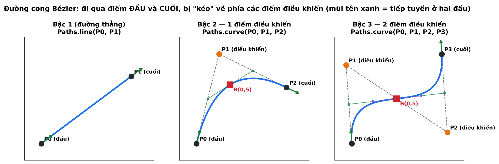

> `t` **không phải thời gian** và các bước `t` đều nhau không tương ứng với quãng đường đều nhau. Pedro tự lo việc đi
> đều trên đường. Bạn chỉ cần vẽ đúng hình dạng.

Trong Pedro v3 (bản có trong virtual_robot):

| Muốn | Viết |
|---|---|
| đoạn thẳng | `Paths.line(a, b)` |
| Bézier qua điểm điều khiển | `Paths.curve(a, c1, b)` hoặc `Paths.curve(a, c1, c2, b)` |
| đường cong **đi qua** các điểm cho trước | `Paths.through(a, m, b)` (Pedro tự tính điểm điều khiển) |
| ghép nhiều đoạn thành một đường | `Paths.path(p1, p2, p3, ...)` |

## 2.3 Nội suy hướng (heading interpolation)

Robot mecanum có thể đi một hướng nhưng **nhìn** một hướng khác. Mỗi đường đi cần một quy tắc chọn hướng:

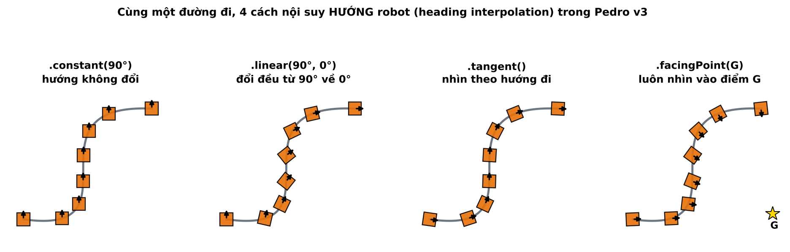

| Phương thức (v3) | Ý nghĩa | Khi nào dùng |
|---|---|---|
| `.constant(h)` hoặc `.constant(pose)` | hướng không đổi | chạy ngang (strafe), giữ camera nhìn một phía |
| `.linear(h0, h1)` hoặc `.linear(poseA, poseB)` | đổi đều từ h0 sang h1 dọc đường | vừa đi vừa xoay về hướng bắn |
| `.tangent()` / `.reverseTangent()` | nhìn theo hướng đi / quay lưng theo hướng đi | đường cong dài, intake ở phía trước/sau |
| `.facingPoint(pose)` | luôn nhìn vào một điểm | vừa chạy vừa ngắm goal |
| `.heading(Interpolator.piecewise().until(0.5, Interpolator.tangent).until(1.0, Interpolator.constant(0)))` | ghép nhiều quy tắc theo `t` | nửa đầu tangent, nửa sau cố định |

Góc trong Pedro tính bằng **radian**. `PoseFactory.degrees().of(x, y, độ)` tạo `Pose` từ độ cho dễ đọc.
`Math.toRadians(...)` đổi độ sang radian.

## 2.4 Follower bám đường như thế nào?

Pedro v3 dùng thuật toán tên **Foresight** ("nhìn trước"). Ý tưởng chính, đơn giản hóa từ mã nguồn của thư viện:

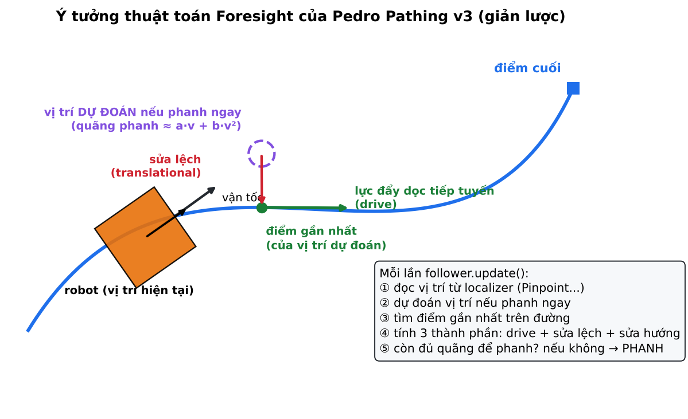

1. **Đọc pose** từ localizer.
2. **Dự đoán**: nếu bắt đầu phanh ngay bây giờ thì robot sẽ trượt tới đâu? Quãng phanh mô hình hóa bằng
   `a·v + b·v·|v|`; các hệ số được đo khi tinh chỉnh (tuning).
3. **Tìm điểm gần nhất** trên đường với vị trí dự đoán đó (tham số `t`).
4. **Tính ba thành phần lực**: *drive* dọc tiếp tuyến của đường, *sửa lệch* (kéo về đường theo phương pháp tuyến) và
   *sửa hướng* (heading).
5. **Phanh đúng lúc**: tốc độ được giới hạn sao cho vẫn kịp dừng ở cuối đường. Hết quãng thì phanh.
6. Phân bổ thành công suất cho 4 bánh mecanum.

**Khi nào đường đi kết thúc?**

- Khi `t` của đoạn cuối ≥ 0,975 → `atParametricEnd()` = `true` (robot *có thể vẫn đang chạy*).
- Sau đó follower tự chuyển sang **HOLD** (giữ chặt điểm cuối, chống bị đẩy). `isBusy()` trở về `false` khi robot đã gần
  như đứng yên đúng chỗ, hoặc sau ~100 ms giữ điểm.
- Một đường ghép nhiều đoạn (`Paths.path(...)`) chạy liền mạch. Mặc định `pathSkip = true`: khi sắp phải phanh ở cuối
  một đoạn, follower *nhảy* sang đoạn sau để giữ đà, nên các góc bị **bo tròn** (Bài tập 2.6).

> ⚠️ `follower.hold(pose)` gọi trực tiếp (không qua một đường đi) **không** đặt lại cờ "bận". `isBusy()` có thể trả về
> `false` ngay lập tức. Khi dùng `hold` để xoay tại chỗ, hãy tự kiểm tra sai số góc hoặc dùng thời gian chờ.

**Giới hạn tốc độ cho riêng một đường** (ví dụ chạy chậm khi hút bóng) bằng *modifier*: giá trị cấu hình bị thay tạm
thời khi chạy đường đó và tự trả lại khi xong.

```java
Path intakeRun = Paths.line(A, B).constant(A)
        .with(Constants.foresightConfig.maxPathSpeed.at(0.35));   // tối đa 35% tốc độ
```

## 2.5 Bảng tra nhanh Pedro Pathing v3

```java
Follower follower = Constants.create(hardwareMap);       // Constants của virtual_robot (đã tinh chỉnh cho MecDynamic)
PoseFactory pf = PoseFactory.degrees();
Pose start = pf.of(24, 24, 90);                          // x, y (inch), heading (độ)
follower.setPose(start);                                 // đặt vị trí đầu cho localizer
Path p = Paths.curve(start, pf.of(60, 48, 0), pf.of(24, 72, 90)).tangent();
follower.follow(p);
// mỗi vòng lặp:
follower.update();                                        // BẮT BUỘC, gọi đều đặn
Pose now = follower.pose();                               // now.x(), now.y(), now.heading() (radian)
boolean dangChay = follower.isBusy();
double tienDo = follower.completion();                    // 0..1 (của đoạn hiện tại)
follower.hold(pf.of(60, 86, 136));                        // giữ chặt một pose
follower.manual(new DrivePowers(tien, sangTrai, quayTrai)); // lái tay (quy ước toán học: trái/ngược kim đồng hồ dương)
follower.mode();                                          // FOLLOW / HOLD / MANUAL / IDLE
```

Nếu đọc tài liệu hoặc code mẫu Pedro **phiên bản 2.x** (phổ biến trên mạng năm 2025), hãy đối chiếu:

| Việc | Pedro 2.x | Pedro 3 (trong virtual_robot) |
|---|---|---|
| tạo follower | `Constants.createFollower(hardwareMap)` | `Constants.create(hardwareMap)` |
| đặt vị trí đầu | `follower.setStartingPose(pose)` | `follower.setPose(pose)` |
| đoạn thẳng / cong | `new BezierLine(a, b)` / `new BezierCurve(a, c, b)` | `Paths.line(a, b)` / `Paths.curve(a, c, b)` |
| ghép đường | `follower.pathBuilder().addPath(...).build()` → `PathChain` | `Paths.path(p1, p2, ...)` |
| hướng | `setLinearHeadingInterpolation`, `setTangentHeadingInterpolation`, `setConstantHeadingInterpolation` | `.linear(...)`, `.tangent()`, `.constant(...)` |
| chạy đường | `follower.followPath(path)` | `follower.follow(path)` |
| đọc pose | `follower.getPose().getX()` | `follower.pose().x()` |
| lái tay | `startTeleopDrive()` + `setTeleOpDrive(...)` | `follower.manual(new DrivePowers(...))` |

Ý tưởng hai bản giống nhau (Bézier, nội suy hướng, `update()` mỗi vòng, `isBusy()`), chỉ khác tên hàm.

## 2.6 Pedro Pathing trong virtual_robot

- Thư viện nằm ở `lib/Pedropathing.jar` (Pedro 3 kèm thư viện lệnh **Ivy**). Hằng số nằm ở
  `TeamCode/.../pedropathing/tuning/Constants.java`: localizer **Pinpoint** (`"pinpoint"`), khung gầm **Mecanum**
  (4 tên motor, 2 motor trái REVERSE) và bộ hệ số Foresight. Tài liệu `Using with PedroPathing and RoadRunner.pdf` trong
  repo khuyên dùng **MecDynamic Bot** vì các hằng số được tinh chỉnh cho cấu hình này.
- OpMode mẫu có sẵn: `BezierCurveOpMode`, `IvyOpMode` (nhóm *PedroExamples*) và `TestsLine`, `TestsCurve`,
  `TestsInterpolation`, `TestsLocalization` (nhóm *PedroTests*). Các OpMode tinh chỉnh (`ForwardVelocity`,
  `ForwardBraking`...) bị `@Disabled`. Trên robot thật **phải** chạy chúng để đo hệ số; trong mô phỏng thì không cần.
- **Hệ tọa độ:** `follower.setPose(START)` khai báo "robot đang ở START". Mọi tọa độ sau đó tính từ đó. Vì vậy hãy
  **đặt robot đúng chỗ và đúng hướng** trước khi INIT, như mục 0.7. Đặt lệch 2–3 in thì cả đường đi lệch theo; đặt sai
  hướng vài độ thì cả đường đi bị xoay theo (thử thách 4 ở Phần 5). Phần 3 sẽ cho robot tự tính vị trí xuất phát bằng
  thẻ AprilTag (ví dụ 3.4).

## 2.7 Ví dụ

### Ví dụ 2.1 — `P2_FirstPath`: đường đi đầu tiên

Đặt robot ở (24, 24) nhìn lên. Robot đi thẳng lên (24, 72) với hướng cố định 90°, rồi đi đường cong về chỗ cũ với
hướng = tiếp tuyến. Viết dạng `OpMode` lặp:

```java
private final PoseFactory pf = PoseFactory.degrees();
private final Pose START = pf.of(24, 24, 90), TOP = pf.of(24, 72, 90), CONTROL = pf.of(60, 48, 0);
...
public void init() {
    follower = Constants.create(hardwareMap);
    up = Paths.line(START, TOP).constant(START.heading());        // giữ 90° suốt đường
    back = Paths.curve(TOP, CONTROL, START).tangent();            // hướng = tiếp tuyến đường cong
}
public void start() { follower.setPose(START); follower.follow(up); step = 1; }
public void loop() {
    follower.update();
    if (step == 1 && !follower.isBusy()) { follower.follow(back); step = 2; }
    else if (step == 2 && !follower.isBusy()) step = 3;          // xong: follower tự HOLD điểm cuối
}
```

Ở cuối, robot nhìn hướng ≈ 214°: đó là hướng tiếp tuyến từ điểm điều khiển (60, 48) về (24, 24).

### Ví dụ 2.2 — `P2_SquarePath`: hình vuông, hướng cố định (LinearOpMode)

```java
Path square = Paths.path(
        Paths.line(a, b).constant(h), Paths.line(b, c).constant(h),
        Paths.line(c, d).constant(h), Paths.line(d, a).constant(h));
follower.follow(square);
do { follower.update(); } while (opModeIsActive() && follower.isBusy());
```

Vì hướng luôn 90°, robot phải **chạy ngang** ở cạnh dưới và cạnh trên. Sai số cuối trong mô phỏng < 1 in.

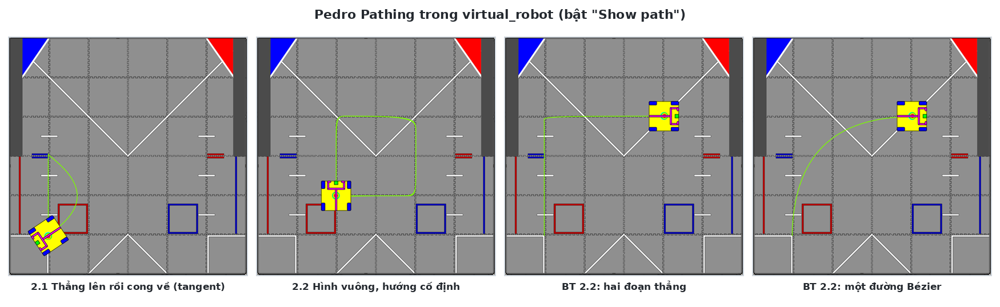

### Ví dụ 2.3 — `P2_DecodeAutoBlue` / `P2_DecodeAutoRed`: Autonomous bằng máy trạng thái

Lớp `DecodePoses` gom các vị trí quan trọng của liên minh **XANH**. Hướng bắn tính từ tọa độ goal, không đoán bằng mắt:

```java
public static double aimHeadingDeg(double x, double y) {
    return Math.toDegrees(Math.atan2(GOAL_Y - y, GOAL_X - x));      // (60, 86) -> 136,2°
}
public DecodePoses(boolean red) {
    PoseFactory pf = red ? PoseFactory.degrees().mirrorX(72) : PoseFactory.degrees();   // ĐỎ = đối xứng qua x = 72
    START = pf.of(56, 9, 90);
    SHOOT = pf.of(60, 86, aimHeadingDeg(60, 86));
    INTAKE_START = pf.of(46, 84, 180);
    INTAKE_END = pf.of(20, 84, 180);
    BASE = pf.of(105, 34, 90);
}
```

`mirrorX(72)` biến x → 144 − x và heading → 180° − heading. **Chỉ viết một lần cho XANH**, bản ĐỎ có ngay
(`P2_DecodeAutoRed` chỉ đặt `red = true`). Máy trạng thái (sách ch. 12):

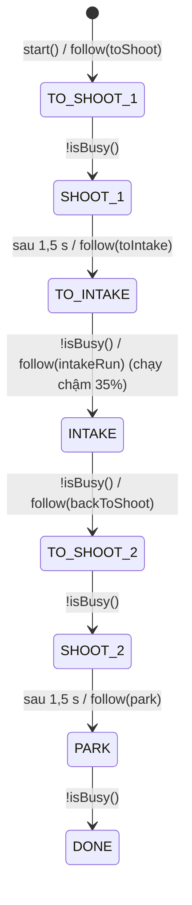

```java
public void loop() {
    follower.update();
    switch (state) {
        case TO_SHOOT_1:
            if (!follower.isBusy()) { timer.reset(); state = State.SHOOT_1; }
            break;
        case SHOOT_1:                                    // chỉ "giả vờ bắn" bằng thời gian chờ (Phần 5 bắn thật)
            if (timer.seconds() > 1.5) { follower.follow(toIntake); state = State.TO_INTAKE; }
            break;
        // ... các trạng thái còn lại cùng một khuôn: "điều kiện xong ? -> ra lệnh mới + đổi trạng thái"
    }
}
```

Toàn bộ kịch bản mất khoảng 12 s, robot về base đúng (105, 34) ở bản xanh và (39, 34) ở bản đỏ. Kịch bản này là
"bộ khung" của Phần 5: ở đó hai trạng thái `SHOOT` không còn chờ 1,5 s nữa mà ngắm bằng AprilTag (Phần 3) rồi bắn
bằng flywheel thật (Phần 4).

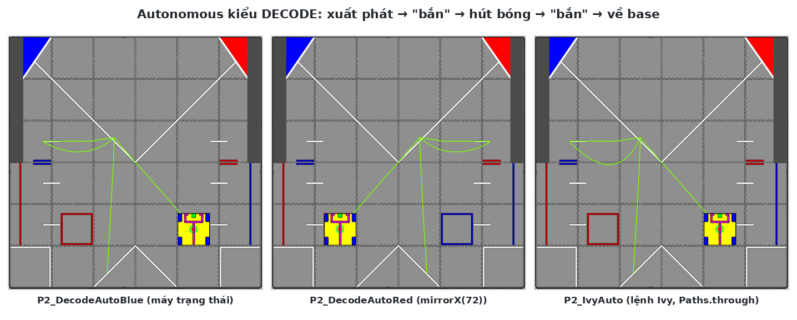

### Ví dụ 2.4 — `P2_IvyAuto`: cùng kịch bản, viết bằng lệnh Ivy

Ivy là thư viện **lệnh (command)** đi kèm Pedro 3. Thay vì tự viết `switch`, bạn *mô tả kịch bản* bằng các khối ghép
được. Ý tưởng giống cây hành vi ở chương 25 của sách:

| Khối | Ý nghĩa |
|---|---|
| `sequential(a, b, c)` | chạy lần lượt |
| `parallel(a, b)` | chạy đồng thời, xong khi **tất cả** xong |
| `race(a, b)` / `deadline(chính, phụ...)` | xong khi **một** lệnh xong / khi lệnh chính xong |
| `instant(() -> ...)` | làm ngay một việc rồi xong |
| `waitMs(t)`, `waitUntil(() -> điều_kiện)` | chờ |
| `repeat(cmd, n)`, `loop(cmd)` | lặp |
| `PedroCommands.follow(follower, path)` | chạy đường đi — **xong khi tới cuối đường theo `t`** (`atParametricEnd`) |

```java
private Command drive(Path path) {
    return sequential(PedroCommands.follow(follower, path),
                      waitUntil(() -> !follower.isBusy()));        // chờ robot DỪNG HẲN (quan trọng trước khi bắn)
}
...
Command auto = sequential(
        say("Đi tới vị trí bắn"), drive(toShoot),
        say("Bắn lần 1"), waitMs(1500),
        parallel(drive(toIntake), sequential(waitMs(300), instant(() -> hand.setPosition(1)))),  // vừa chạy vừa mở tay
        drive(intakeRun),
        instant(() -> hand.setPosition(0)),
        drive(back), say("Bắn lần 2"), waitMs(1500),
        drive(park), say("XONG"));
Scheduler.schedule(auto);              // trong init()
...
follower.update(); Scheduler.execute(); // trong loop()
```

> Nhớ `Scheduler.reset()` ở đầu `init()`: Scheduler là `static`, nếu không xóa thì lệnh của lần chạy trước còn sót lại.

### Ví dụ 2.5 — `P2_TeleOpPedro`: Pedro trong TeleOp

- Lái tay bằng `follower.manual(new DrivePowers(-ly, -lx, -rx))`. Dấu trừ vì Pedro dùng quy ước toán học: tiến, sang
  **trái** và quay **ngược** kim đồng hồ là dương.
- **X**: lái theo hệ **sân** bằng `ManualDrive.fieldCentric(stick, heading − 90°)`. Trừ 90° vì người lái đứng ở cạnh
  dưới nhìn lên, "phía trước" của người lái là hướng 90° của sân.
- **Y**: tự lái tới vị trí bắn bằng một đường thẳng tạo ngay lúc bấm, từ pose hiện tại.
- **A**: `follower.hold(follower.pose())` để giữ chặt vị trí, chống bị robot khác đẩy. **B**: trở lại lái tay.

## 2.8 Bài tập Phần 2

**Bài 2.1 (★) — Tính tay Bézier.** Cho P0 = (24, 24), P1 = (24, 96), P2 = (96, 96).
a) Tính B(0,5). b) Robot rời P0 và tới P2 theo hướng nào nếu dùng `.tangent()`?

<details>
<summary>Lời giải 2.1</summary>

a) B(0,5) = 0,25·P0 + 0,5·P1 + 0,25·P2 = (6 + 12 + 24; 6 + 48 + 24) = **(42; 78)**. Điểm này không nằm trên đoạn
P0P1 hay P1P2: đường cong "cắt góc".
b) Tiếp tuyến ở đầu cùng hướng P0 → P1 = (0, 72) → **90°**. Ở cuối cùng hướng P1 → P2 = (72, 0) → **0°**.

</details>

**Bài 2.2 (★) — Đường chữ L.** Từ (24, 24) đi lên (24, 96) rồi sang phải (96, 96), robot luôn nhìn theo hướng đi.
Làm bằng 2 cách: hai đoạn thẳng và một đường Bézier. So sánh khi chạy.

<details>
<summary>Lời giải 2.2 — <code>solutions/S2_2_LPath.java</code></summary>

```java
Pose a = pf.of(24, 24, 90), corner = pf.of(24, 96, 0), b = pf.of(96, 96, 0);
Path twoLines = Paths.path(Paths.line(a, corner).tangent(), Paths.line(corner, b).tangent());
Path smooth   = Paths.curve(a, corner, b).tangent();     // góc trở thành ĐIỂM ĐIỀU KHIỂN
```

Hai đoạn thẳng: robot phải xoay 90° tại góc (có bo nhẹ do `pathSkip`). Bézier: đi một cung tròn trơn, nhanh hơn
nhưng **không đi qua** điểm góc (24, 96). Trong lúc INIT bấm **A** để chọn cách 2 (xem ảnh ở mục 2.7).

</details>

**Bài 2.3 (★★) — Thêm lượt hút bóng thứ hai.** Sửa `P2_DecodeAutoBlue`: sau lần bắn 2, đi hút bóng ở vạch y = 60
(từ x = 46 tới x = 20), quay lại bắn lần 3 rồi mới về base. Không được quá 30 s.

<details>
<summary>Lời giải 2.3 — <code>solutions/S2_3_ThreeCycles.java</code></summary>

Thêm 2 pose, 3 đường đi và 3 trạng thái mới; `SHOOT_2` không đi `park` nữa mà đi tới vạch thứ hai:

```java
Pose INTAKE2_START = pf.of(46, 60, 180), INTAKE2_END = pf.of(20, 60, 180);
Path toIntake2  = Paths.line(P.SHOOT, INTAKE2_START).linear(P.SHOOT, INTAKE2_START);
Path intakeRun2 = Paths.line(INTAKE2_START, INTAKE2_END).constant(INTAKE2_START)
                       .with(Constants.foresightConfig.maxPathSpeed.at(0.35));
Path back2      = Paths.curve(INTAKE2_END, pf.of(44, 60, 0), P.SHOOT).linear(INTAKE2_END, P.SHOOT);

enum State {TO_SHOOT_1, SHOOT_1, TO_INTAKE, INTAKE, TO_SHOOT_2, SHOOT_2,
            TO_INTAKE_2, INTAKE_2, TO_SHOOT_3, SHOOT_3, PARK, DONE}
...
case SHOOT_2:
    if (timer.seconds() > 1.5) { follower.follow(toIntake2); state = State.TO_INTAKE_2; }
    break;
case TO_INTAKE_2:
    if (!follower.isBusy()) { follower.follow(intakeRun2); state = State.INTAKE_2; }
    break;
case INTAKE_2:
    if (!follower.isBusy()) { follower.follow(back2); state = State.TO_SHOOT_3; }
    break;
case TO_SHOOT_3:
    if (!follower.isBusy()) { timer.reset(); state = State.SHOOT_3; }
    break;
case SHOOT_3:
    if (timer.seconds() > 1.5) { follower.follow(park); state = State.PARK; }
    break;
```

Kết quả mô phỏng: mỗi vòng "tới vạch → hút → quay lại → bắn" mất khoảng 6,5 s. Cả kịch bản xong sau khoảng **19 s**
(bản gốc khoảng 12 s), vẫn dưới 30 s. Lời giải in thêm dòng "Xong toàn bộ sau" để bạn kiểm tra.

</details>

**Bài 2.4 (★★) — Chạy ngang mà vẫn ngắm goal.** Robot chạy qua lại giữa (48, 100) và (100, 100) nhưng **luôn**
nhìn vào goal xanh (10, 134).

<details>
<summary>Lời giải 2.4 — <code>solutions/S2_4_StrafeFacingGoal.java</code></summary>

```java
Pose goal = pf.of(DecodePoses.GOAL_X, DecodePoses.GOAL_Y, 0);
Path go   = Paths.line(left, right).facingPoint(goal);
Path back = Paths.line(right, left).facingPoint(goal);
```

Trong mô phỏng, sai lệch giữa hướng robot và hướng goal chỉ khoảng **0,2–0,4°** khi đang chạy. Đây là nền tảng cho
việc vừa di chuyển vừa ngắm mục tiêu khi robot có cơ cấu bắn (thử thách 6 ở Phần 5).

</details>

**Bài 2.5 (★★★) — TeleOp khóa hướng.** Lái theo hệ sân. Khi giữ **LB**, robot tự quay để luôn nhìn goal xanh. Người lái
vẫn tiến/lùi/sang ngang bằng cần trái.

<details>
<summary>Lời giải 2.5 — <code>solutions/S2_5_HeadingLockTeleOp.java</code></summary>

```java
double turn = -gamepad1.right_stick_x;
if (gamepad1.left_bumper) {
    double target = Math.atan2(DecodePoses.GOAL_Y - p.y(), DecodePoses.GOAL_X - p.x());
    double err = target - p.heading();
    err = Math.atan2(Math.sin(err), Math.cos(err));         // chuẩn hóa về (-π, π]
    turn = headingPid.calculate(0, -err);                    // = kP·err + kD·d(err)/dt (lớp util/Pidf)
}
DrivePowers stick = new DrivePowers(-gamepad1.left_stick_y, -gamepad1.left_stick_x, turn);
follower.manual(ManualDrive.fieldCentric(stick, p.heading() - Math.PI / 2));
```

Mẹo `atan2(sin e, cos e)` chuẩn hóa góc mà không cần vòng `while`. Kết quả mô phỏng: đứng yên thì sai lệch hướng ≈ 0°,
vừa giữ LB vừa chạy ngang thì sai lệch không quá ~1,5°. Lời giải này ngắm theo **tọa độ** (tin odometry). Ở ví dụ 4.5,
nút LB làm cùng việc nhưng ngắm theo **camera** (`bearing` của thẻ goal, Phần 3), nên vẫn đúng khi odometry đã trôi.

</details>

**Bài 2.6 (★) — Góc vuông sắc nét.** Vì sao hình vuông của ví dụ 2.2 bị bo góc? Hãy làm cho góc sắc mà vẫn chạy cả
hình vuông bằng **một** lệnh `follow`.

<details>
<summary>Lời giải 2.6 — <code>solutions/S2_6_SharpSquare.java</code></summary>

Do `pathSkip = true`: khi bắt đầu phải phanh ở cuối một cạnh, follower chuyển sớm sang cạnh sau để giữ đà, nên robot
cắt góc. Tắt tùy chọn này **chỉ cho đường hình vuông** bằng một modifier:

```java
Modifier noSkip = Constants.foresightConfig.pathSkip.at(false);
Path square = Paths.path(Paths.line(a, b).constant(h), Paths.line(b, c).constant(h),
                         Paths.line(c, d).constant(h), Paths.line(d, a).constant(h)).with(noSkip);
```

Đánh đổi: góc sắc hơn nhưng robot phải giảm tốc ở mỗi góc, nên chậm hơn. Trong thi đấu thường **giữ bo góc** cho
nhanh, trừ khi cần đi sát vật cản.

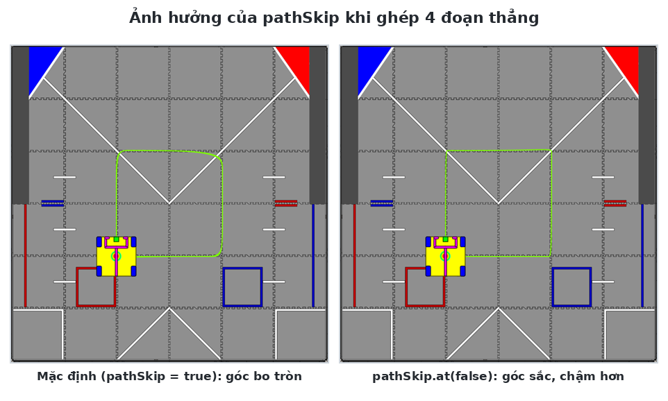

</details>

---

# Phần 3 — AprilTag

> **Mục tiêu:** hiểu AprilTag và ý nghĩa của `ftcPose` (`range`, `bearing`, `yaw`, `x`, `y`, `z`, `elevation`). Đọc
> motif DECODE, tự ngắm, tự tiến tới thẻ, và **định vị lại** robot bằng thẻ goal để sửa sai số odometry.
> **Cấu hình:** **Shooter Bot** + camera giả lập `SimAprilTagCamera` (mục 3.4).
> **Sách:** ch. 16 (*Computer Vision*: `AprilTagProcessor`, `VisionPortal`), ch. 23.2 (*Localization with AprilTags*).
> **Dựa trên:** Phần 1 (điều khiển P, lớp `MecanumDrive`), Phần 2 (pose, hệ tọa độ, Pedro). **Dùng lại ở:** Phần 4
> (`range` → tốc độ flywheel), Phần 5 (đọc motif, ngắm trước khi bắn).

**Vì sao cần AprilTag khi đã có odometry?** Odometry (Phần 1–2) chỉ biết robot đã đi bao xa **kể từ lúc xuất phát**.
Đặt robot lệch lúc đầu, bị va chạm hay trượt bánh thì sai số đó theo robot tới cuối trận (mục 2.6). Thẻ AprilTag là các
**mốc cố định** trên sân: nhìn thấy thẻ là biết ngay mình đang ở đâu so với mốc đó, goal nằm ở hướng nào và cách bao
xa. Đó cũng chính là hai con số mà cơ cấu bắn ở Phần 4 cần.

## 3.1 AprilTag là gì?

AprilTag là một loại "mã vạch 2D" đơn giản (Đại học Michigan). Mỗi thẻ mã hóa một **số ID**. FTC dùng họ thẻ
**tag36h11**: 36 bit dữ liệu trên lưới 6×6 ô. Hai thẻ bất kỳ trong họ khác nhau ít nhất 11 bit, nên thẻ bị che một phần
hoặc ảnh hơi nhòe vẫn khó bị đọc nhầm sang ID khác.

Camera tìm **4 góc** của thẻ trong ảnh. Biết thêm **kích thước thật** của thẻ và **thông số ống kính** (tiêu cự, tâm ảnh),
phần mềm giải bài toán *PnP* (Perspective-n-Point) để tính **vị trí và hướng của thẻ so với camera**. Vì vậy:

- Thẻ phải có trong **thư viện thẻ** (để biết kích thước). Thẻ lạ chỉ cho ID, không cho vị trí.
- Camera phải được **hiệu chỉnh** (calibration). SDK có sẵn thông số cho các webcam phổ biến. Webcam lạ thì phải
  tự cung cấp bằng `setLensIntrinsics(fx, fy, cx, cy)`, nếu không mọi khoảng cách đều sai.

**Thẻ trên sân DECODE** (thư viện `AprilTagGameDatabase.getDecodeTagLibrary()` của SDK, thẻ cạnh 6,5 in):

| ID | Tên trong SDK | Gắn ở đâu | Dùng để |
|---|---|---|---|
| 20 | `BlueTarget` | goal **xanh** (góc trên-trái); trong hệ tọa độ của tài liệu ở (16,4; 130,4), cao 29,5 in | ngắm, đo khoảng cách, **định vị** |
| 24 | `RedTarget` | goal **đỏ** (góc trên-phải); (127,6; 130,4), cao 29,5 in | ngắm, đo khoảng cách, **định vị** |
| 21 | `Obelisk_GPP` | obelisk ngoài tường trên | motif **xanh lá – tím – tím** |
| 22 | `Obelisk_PGP` | obelisk | motif **tím – xanh lá – tím** |
| 23 | `Obelisk_PPG` | obelisk | motif **tím – tím – xanh lá** |

> Trong thư viện SDK, thẻ obelisk **chỉ có kích thước, không có vị trí trên sân**. Obelisk được xoay ngẫu nhiên mỗi
> trận nên không thể có vị trí cố định. Vì vậy **chỉ dùng thẻ 20 và 24 để định vị**. Thẻ 21–23 chỉ dùng để đọc motif.

## 3.2 `ftcPose`: thẻ nằm ở đâu so với camera?

Mỗi lần nhìn thấy thẻ, SDK trả về một `AprilTagDetection`. Trường `ftcPose` mô tả thẻ **so với ống kính camera**:

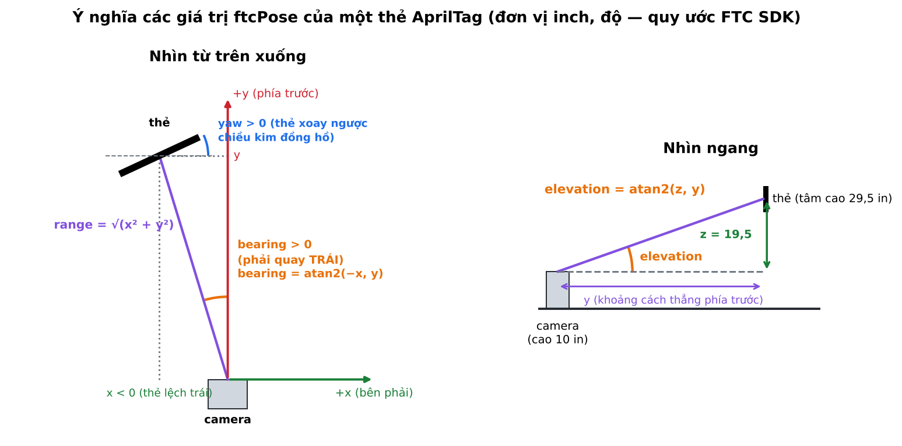

| Giá trị | Ý nghĩa | Dấu |
|---|---|---|
| `x` | lệch ngang | **dương = thẻ ở bên PHẢI** tâm ảnh |
| `y` | khoảng cách thẳng phía trước camera | luôn dương |
| `z` | chênh lệch độ cao | dương = thẻ **cao hơn** camera |
| `range` | khoảng cách, đo **trên mặt phẳng ngang** | `range = √(x² + y²)` |
| `bearing` | góc camera phải **quay** để nhìn thẳng vào tâm thẻ | **dương = quay TRÁI**; `bearing = atan2(−x, y)` |
| `elevation` | góc camera phải **ngẩng** để nhìn vào tâm thẻ | dương = ngẩng lên; `elevation = atan2(z, y)` |
| `yaw` | thẻ xoay quanh trục đứng so với mặt camera | **dương = ngược chiều kim đồng hồ**; 0 = mặt thẻ song song với mặt camera |
| `pitch`, `roll` | thẻ nghiêng / xoay trong ảnh | thường ≈ 0 với thẻ dán đứng |

Ba công thức trong bảng lấy đúng từ mã nguồn SDK (`AprilTagProcessorImpl`). Đơn vị do bạn chọn bằng
`setOutputUnits(...)`. Tài liệu luôn dùng **inch** và **độ**.

**Quy tắc dễ nhớ (dùng cho cả Phần 4 và Phần 5):**

- **`bearing` → QUAY.** `bearing > 0`: thẻ lệch trái, robot cần quay trái. Robot đang nhìn thẳng vào thẻ mà **quay
  trái 10°** thì `bearing` thành **−10°** (thẻ trôi sang phải trong ảnh).
- **`range` → TIẾN/LÙI.** Dùng để dừng đúng khoảng cách, hoặc chọn tốc độ flywheel (Phần 4).
- **`yaw` → ĐI NGANG.** `yaw` phụ thuộc cả hướng camera lẫn vị trí: `yaw = bearing − α`, trong đó α là góc lệch của
  camera so với **pháp tuyến** của thẻ (đường vuông góc với mặt thẻ), nhìn từ thẻ. Khi robot đã nhìn thẳng vào thẻ
  (`bearing ≈ 0`): **`yaw > 0` nghĩa là robot đứng lệch về phía TAY TRÁI của nó** so với pháp tuyến. Muốn về đúng
  pháp tuyến thì đi ngang sang **phải**.

> **Camera đo tới thẻ, không phải tới tâm miệng goal.** Camera giả lập lắp 8 in phía trước tâm robot, còn thẻ 20 nằm
> lệch tâm miệng goal (10, 134) vài inch. Vì vậy:
>
> - `range` là khoảng cách ống kính → thẻ. Bảng tra tốc độ ở Phần 4 được **đo bằng chính `range` này** nên dùng thẳng
>   được. Khi tính bằng công thức vật lý (bài 4.6) thì phải đổi ra khoảng cách từ điểm bóng rời nòng tới tâm miệng
>   goal. Dời camera sang chỗ khác trên robot thì bảng tra phải đo lại.
> - `bearing = 0` nghĩa là camera nhìn thẳng vào **thẻ**. Từ vị trí bắn (60, 86), hướng này lệch hướng tới tâm miệng
>   goal khoảng 2°, làm bóng lệch ngang ≈ 2 in ở khoảng cách 61 in: vẫn nằm trong dung sai ±7 in (mục 4.2).

## 3.3 AprilTag trên robot thật: `VisionPortal`

Sách (Listing 16.1) dùng cách ngắn nhất: `AprilTagProcessor.easyCreateWithDefaults()` và
`VisionPortal.easyCreateWithDefaults(...)`. Khi thi đấu, bạn nên tự cấu hình để có đơn vị, thư viện thẻ và vị trí
camera đúng. Lớp mechanism dưới đây viết theo phong cách của sách (ch. 6):

```java
// ⚠ CHỈ DÀNH CHO ROBOT THẬT (FTC SDK ≥ 10.0) — virtual_robot không có VisionPortal/webcam thật.
import android.util.Size;
import com.qualcomm.robotcore.hardware.HardwareMap;
import org.firstinspires.ftc.robotcore.external.hardware.camera.WebcamName;
import org.firstinspires.ftc.robotcore.external.navigation.*;
import org.firstinspires.ftc.vision.VisionPortal;
import org.firstinspires.ftc.vision.apriltag.*;

public class TagCamera {
    private AprilTagProcessor aprilTag;
    private VisionPortal portal;

    public void init(HardwareMap hwMap) {
        // Camera 8 in phía trước tâm robot, cao 10 in, nhìn thẳng về phía trước.
        Position camPos = new Position(DistanceUnit.INCH, 0, 8, 10, 0);                       // x phải, y trước, z lên
        YawPitchRollAngles camRot = new YawPitchRollAngles(AngleUnit.DEGREES, 0, -90, 0, 0);   // pitch −90° = nằm ngang

        aprilTag = new AprilTagProcessor.Builder()
                .setTagLibrary(AprilTagGameDatabase.getCurrentGameTagLibrary())
                .setOutputUnits(DistanceUnit.INCH, AngleUnit.DEGREES)
                .setCameraPose(camPos, camRot)             // để SDK tính sẵn detection.robotPose
                .build();
        aprilTag.setDecimation(2);                         // 1: thấy xa hơn nhưng chậm; 3: nhanh nhưng tầm ngắn

        portal = new VisionPortal.Builder()
                .setCamera(hwMap.get(WebcamName.class, "Webcam 1"))
                .setCameraResolution(new Size(640, 480))
                .addProcessor(aprilTag)
                .build();
    }

    /** Thẻ có id cho trước, hoặc null nếu không thấy — cùng cách dùng với SimAprilTagCamera.getDetection(). */
    public AprilTagDetection getDetection(int id) {
        for (AprilTagDetection d : aprilTag.getDetections()) {
            if (d.metadata == null) continue;     // thẻ không có trong thư viện => ftcPose = null
            if (d.id == id) return d;
        }
        return null;
    }
}
```

**Đọc vị trí robot mà SDK tính sẵn** (chỉ có khi đã gọi `setCameraPose`, và chỉ có ý nghĩa với thẻ 20/24):

```java
double xSdk = d.robotPose.getPosition().x;                          // hệ tọa độ SDK: gốc ở TÂM sân
double ySdk = d.robotPose.getPosition().y;
double hSdk = d.robotPose.getOrientation().getYaw(AngleUnit.DEGREES);
// Đổi sang hệ của tài liệu (mục 0.7):  x = ySdk + 72,  y = 72 − xSdk,  heading = hSdk + 90°
```

Lần đầu dùng `robotPose`, hãy đặt robot ở một vị trí **đo sẵn bằng thước** rồi so sánh cả vị trí lẫn hướng với giá
trị SDK trả về, và tự thêm phần bù nếu cần. Khai báo sai vị trí hoặc hướng lắp camera là lỗi hay gặp nhất.

**Mẹo để AprilTag ổn định trên robot thật:**

| Vấn đề | Cách xử lý |
|---|---|
| Ảnh nhòe khi robot chạy hoặc quay | phơi sáng ngắn + tăng gain (mẫu `ConceptAprilTagOptimizeExposure`): `portal.getCameraControl(ExposureControl.class)` → `setMode(Manual)`, `setExposure(6, TimeUnit.MILLISECONDS)`; `GainControl.setGain(...)`. Chỉ gọi khi `portal.getCameraState() == STREAMING` |
| Chậm, tốn CPU | `setDecimation(3)` khi ở gần; độ phân giải 640×480; tắt bộ xử lý khi không cần: `portal.setProcessorEnabled(aprilTag, false)`. Sách gọi `visionPortal.stopStreaming()` trong `start()` khi chỉ cần đọc thẻ lúc INIT |
| Kết quả "giật" | trung bình nhiều lần đo, loại lần đo quá xa hoặc quá xiên, chỉ tin camera khi robot gần như đứng yên |
| Trễ (latency) | ảnh được chụp trước khi bạn đọc kết quả vài chục ms. Robot càng nhanh, vị trí đo càng "cũ" |
| Obelisk có nhiều mặt | tài liệu FTC khuyên đặt robot sao cho **chỉ thấy mặt trước** của obelisk, không dựa vào thứ tự các thẻ |

**Limelight 3A (sách ch. 23.2):** camera thông minh tự tính vị trí robot từ thẻ: `llResult.getBotpose()` (MegaTag).
Theo tài liệu của Limelight, bản MegaTag2 cần bạn đưa hướng robot từ IMU vào (`limelight.updateRobotOrientation(yaw)`
rồi đọc `getBotpose_MT2()`). Đây cũng chính là ý tưởng của hàm `robotPoseWithHeading` trong mục 3.5: **lấy hướng từ
IMU, chỉ lấy khoảng cách và góc từ camera**.

## 3.4 Camera giả lập trong virtual_robot

virtual_robot không mô phỏng camera: `AprilTagProcessor.getDetections()` của nó luôn trả về `null`. Vì vậy tài liệu
kèm theo lớp **`SimAprilTagCamera`**. Lớp này đọc **vị trí thật** của robot (`SimTruth`), rồi tính bằng hình học xem một
webcam gắn trên robot nhìn thấy thẻ nào, với `range`, `bearing`, `yaw`... theo **đúng công thức của SDK**:

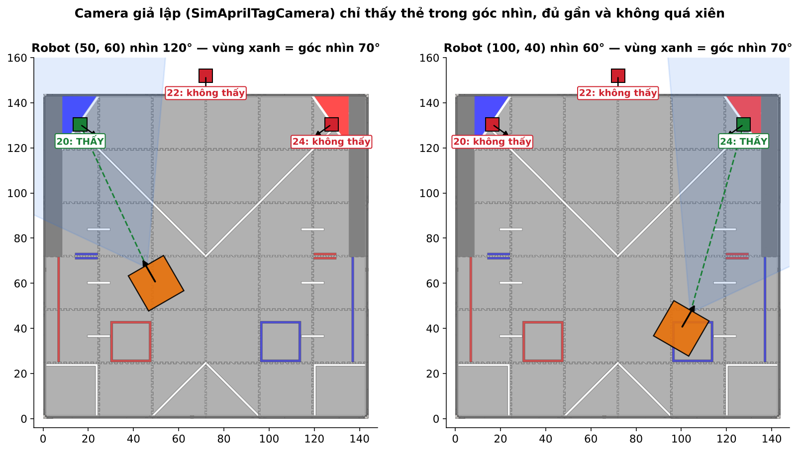

| Thông số (trường public, có thể sửa) | Mặc định | Ý nghĩa |
|---|---|---|
| vị trí lắp `(forward, left, height, yaw)` | `(8, 0, 10, 0)` | 8 in phía trước tâm, cao 10 in, nhìn thẳng. Đổi bằng `new SimAprilTagCamera(f, l, h, yaw)` |
| `H_FOV_DEG` / `V_FOV_DEG` | 70° / 50° | góc nhìn ngang / dọc. Thẻ phải có `bearing` trong ±35° và `elevation` trong ±25° |
| `MIN_RANGE_IN` / `MAX_RANGE_IN` | 6 / 160 in | quá gần hoặc quá xa thì không đọc được |
| `MAX_VIEW_ANGLE_DEG` | 70° | nhìn mặt thẻ quá xiên thì không đọc được |
| `noiseEnabled` | `true` | nhiễu: `range` ± (0,2 + 0,6% range) in, `bearing`/`elevation` ± 0,3°, `yaw` ± (1 + 0,015·range)° |
| `DROPOUT_PROBABILITY` | 0,03 | 3% khung hình "rớt" (không thấy thẻ dù thẻ trong tầm), chỉ khi bật nhiễu |

- Thẻ obelisk được **chọn ngẫu nhiên** mỗi lần tạo camera (giống motif bốc thăm mỗi trận). Hàm
  `getObeliskIdForTesting()` cho biết đáp án để bạn tự chấm bài.
- Tên trường **giống hệt SDK**, nên code chuyển sang robot thật gần như không phải sửa:

| Trong mô phỏng | Trên robot thật |
|---|---|
| `new SimAprilTagCamera()` | `AprilTagProcessor` + `VisionPortal` (lớp `TagCamera` ở 3.3) |
| `camera.getDetections()` → `List<SimTagDetection>` | `aprilTag.getDetections()` → `List<AprilTagDetection>` |
| `d.id`, `d.metadata.name`, `d.ftcPose.range / bearing / yaw / x / y / z / elevation` | giống hệt (nhớ kiểm tra `d.metadata != null`) |
| `TagLocalizer.robotPose(...)` (tự tính, mục 3.5) | `d.robotPose` (SDK tính sẵn) hoặc tự tính như tài liệu |
| `SimTruth` (vị trí thật để so sánh) | **không có**, chỉ có thước đo và mắt người |

## 3.5 Ví dụ

### Ví dụ 3.1 — `P3_TagTelemetry`: camera nhìn thấy gì?

Đặt robot ở **(50, 60)** nhìn **120°**, chạy OpMode, lái quanh sân bằng gamepad (cần trái: tiến/ngang, cần phải: quay):

```java
List<SimTagDetection> detections = camera.getDetections();
telemetry.addData("Số thẻ thấy được", detections.size());
for (SimTagDetection d : detections) {
    telemetry.addLine(String.format("== ID %d (%s) ==", d.id, d.metadata.name));
    telemetry.addLine(String.format("   range %.1f in | bearing %.1f° | yaw %.1f°",
            d.ftcPose.range, d.ftcPose.bearing, d.ftcPose.yaw));
}
```

Kết quả (đã tắt nhiễu bằng **B**): thẻ 20 có `range ≈ 70 in`, `bearing ≈ −5°`, `yaw ≈ +24,6°`,
`elevation ≈ 15,6°`. Đọc kết quả: thẻ hơi lệch phải (robot cần quay phải 5° để ngắm). Robot đứng lệch về phía tay trái
của nó so với pháp tuyến thẻ (yaw dương). Tâm thẻ cao hơn camera 19,5 in.

Thử nghiệm: **quay tại chỗ** → `bearing` và `yaw` cùng đổi, `range` gần như giữ nguyên. **Tiến lại gần** → `range`
giảm, `elevation` tăng. **Đi vòng sang bên** (luôn nhìn vào thẻ) → `yaw` đổi dấu khi bạn đi qua pháp tuyến của thẻ.
**Bật nhiễu** → các số dao động. Thẻ càng xa thì `yaw` dao động càng mạnh.

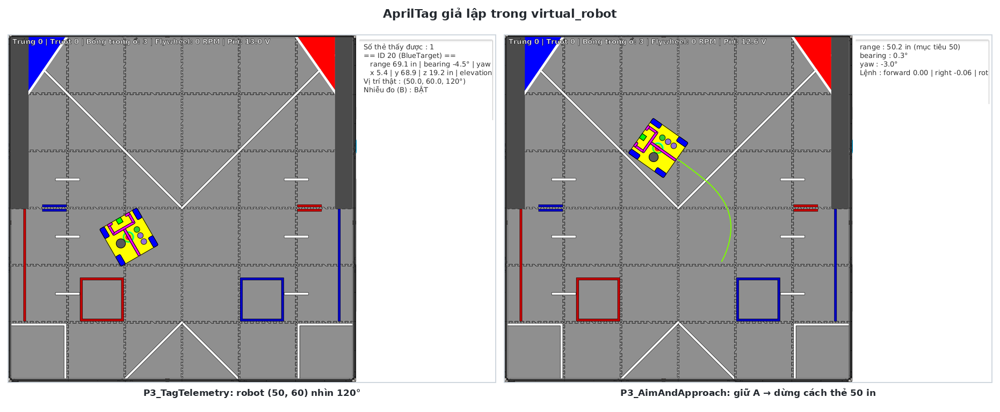

### Ví dụ 3.2 — `P3_ReadMotif`: đọc motif lúc INIT (giống sách, Listing 16.1)

Đặt robot ở **(72, 60)** nhìn **lên** (90°), về phía obelisk. Code đọc thẻ trong `init_loop()`, giống ví dụ của sách,
nhưng thêm một bộ lọc: chỉ **chốt** motif khi cùng một ID xuất hiện **5 lần liên tiếp**:

```java
public void init_loop() {
    for (SimTagDetection d : camera.getDetections()) {
        if (d.id < 21 || d.id > 23) continue;              // bỏ qua thẻ goal (20, 24)
        sameCount = (d.id == lastId) ? sameCount + 1 : 1;
        lastId = d.id;
        if (sameCount >= 5) motif = motifFromId(d.id);     // 21 -> "GPP", 22 -> "PGP", 23 -> "PPG"
    }
    telemetry.addData("Motif", motif);
}
```

Sau START, OpMode in thêm "đáp án của mô phỏng" để bạn kiểm tra. Chạy STOP/INIT nhiều lần: motif đổi ngẫu nhiên.
Trên robot thật, hãy đọc motif **càng sớm càng tốt**: trong `init_loop()` nếu camera đã nhìn thấy obelisk, hoặc ngay đầu
Autonomous. Luôn có **giá trị dự phòng** (ví dụ mặc định "GPP") nếu không đọc được, để robot vẫn chạy tiếp.

### Ví dụ 3.3 — `P3_AimAndApproach`: tự ngắm và tự tiến tới thẻ

Đây là phiên bản mô phỏng của mẫu `RobotAutoDriveToAprilTagOmni` trong SDK. Robot **không cần biết mình ở đâu trên
sân**. Ba bộ điều khiển P chạy song song, mỗi bộ đưa một sai số về 0:

| Sai số | Ý nghĩa khi dương | Lệnh (quy ước `MecanumDrive` của sách: `rotate > 0` = quay phải) |
|---|---|---|
| `bearing` | thẻ lệch trái | `rotate = −K_TURN × bearing` (K_TURN = 0,015) |
| `range − 50` | còn xa hơn 50 in | `forward = K_DRIVE × (range − 50)` (K_DRIVE = 0,03) |
| `yaw` | robot lệch về tay trái so với pháp tuyến | `right = K_STRAFE × yaw` (K_STRAFE = 0,02) |

```java
SimTagDetection tag = camera.getDetection(TARGET_ID);
if (tag != null && (gamepad1.left_bumper || gamepad1.a)) {          // LB: chỉ ngắm; A: ngắm + tiến + căn giữa
    rotate = Range.clip(-K_TURN * tag.ftcPose.bearing, -MAX_TURN, MAX_TURN);
    if (gamepad1.a) {
        forward = Range.clip(K_DRIVE * (tag.ftcPose.range - DESIRED_RANGE), -MAX_DRIVE, MAX_DRIVE);
        right   = Range.clip(K_STRAFE * tag.ftcPose.yaw, -MAX_STRAFE, MAX_STRAFE);
    }
}
drive.drive(forward, right, rotate);
```

Kết quả: từ (90, 50) nhìn 100°, giữ **A** 6 giây → `range = 50,2 in`, `bearing = 0,3°`, còn `yaw` dao động vài độ
quanh 0 (ở 50 in, nhiễu của `yaw` khoảng ±1,8°). Robot đi theo một đường cong để vừa tới gần vừa về đúng pháp tuyến
của thẻ (ảnh phải ở trên).

> **Vì sao dừng ở 50 in mà không gần hơn?** Tâm thẻ cao hơn camera 19,5 in, còn nửa góc nhìn dọc là 25°. Thẻ ra khỏi
> khung hình khi `y < 19,5 / tan 25° ≈ 41,8 in`. Khi mất thẻ, `tag == null` nên robot dừng tự động. Robot thật cũng gặp
> đúng vấn đề này. Cách xử lý: ngửa camera lên (khai báo đúng `pitch` trong `setCameraPose`), lắp camera cao hơn, hoặc
> chọn khoảng dừng xa hơn.

> **SDK viết dấu khác?** Trong mẫu của SDK, hàm `moveRobot(x, y, yaw)` dùng quy ước **trái và ngược kim đồng hồ là
> dương**, nên code ở đó là `turn = +gain × bearing` và `strafe = −gain × yaw`. Hai cách viết là một, chỉ khác quy ước
> dấu của hàm lái. **Luôn kiểm tra quy ước của hàm lái** trước khi chép công thức.

### Ví dụ 3.4 — `P3_Relocalize`: định vị lại bằng thẻ goal

Odometry (Pinpoint, encoder) **trôi dần** khi va chạm hoặc trượt bánh. Pinpoint của virtual_robot thì không bao giờ
trôi. Vì vậy ví dụ này mô phỏng tình huống "không biết robot đang ở đâu": đặt robot **ở bất kỳ đâu** trong nửa dưới sân,
miễn là camera thấy thẻ 20 hoặc 24. Robot tự tính vị trí từ thẻ, khai báo cho Pedro, rồi chạy tới vị trí bắn (60, 86).

**Thuật toán `TagLocalizer.robotPose` (hệ tọa độ của tài liệu: độ, 0° = +x, ngược kim đồng hồ dương):**

1. Hướng camera: `camHeading = facing_thẻ − yaw + 180°`, đảo ngược định nghĩa của `yaw`.
2. Hướng từ camera tới thẻ: `toTag = camHeading + bearing`.
3. Vị trí camera: `cam = vị_trí_thẻ − range × (cos toTag, sin toTag)`.
4. Vị trí tâm robot: `robot = cam − (8 cos h, 8 sin h)`, với h là hướng robot (camera lắp 8 in phía trước tâm).

**Tính tay với số liệu của ví dụ 3.1** (thẻ 20 ở (16,4; 130,4), mặt thẻ hướng −35,4°; đo được range 70,0,
bearing −5,0°, yaw 24,6°):

| Bước | Phép tính | Kết quả |
|---|---|---|
| 1 | −35,4 − 24,6 + 180 | camHeading = **120,0°** |
| 2 | 120,0 + (−5,0) | toTag = 115,0° |
| 3 | (16,4 − 70·cos 115°; 130,4 − 70·sin 115°) | camera ở (45,98; 66,96) |
| 4 | (45,98 − 8·cos 120°; 66,96 − 8·sin 120°) | robot ở **(49,98; 60,03)**. Đúng là (50, 60)! |

Trong `init_loop()`, OpMode cộng dồn rất nhiều lần đo (hàng nghìn lần trong 1–2 giây INIT) rồi lấy **trung bình**.
Trung bình góc phải cộng `cos` và `sin` rồi dùng `atan2`, không cộng thẳng số độ. Ví dụ: trung bình của 179° và −179°
là 180°, không phải 0°.

```java
double[] e = TagLocalizer.robotPose(d, CAM_FWD, CAM_LEFT, CAM_YAW);
sumX += e[0];  sumY += e[1];
sumCos += Math.cos(Math.toRadians(e[2]));  sumSin += Math.sin(Math.toRadians(e[2]));
...
startEstimate = new Pose(sumX / samples, sumY / samples, Math.atan2(sumSin, sumCos));
follower.setPose(startEstimate);
follower.follow(Paths.line(startEstimate, P.SHOOT).linear(startEstimate, P.SHOOT));
```

| Thử nghiệm | Pedro bắt đầu từ | Robot dừng ở (vị trí thật) | Sai lệch so với (60, 86) |
|---|---|---|---|
| Đặt robot ở (95, 45, 125°), **dùng AprilTag** | (95,0; 45,2; 125,0°) | (60,0; 85,9; 136,1°) | **0,1 in** |
| Cùng chỗ, bấm **X** lúc INIT để **tắt** AprilTag (Pedro tưởng robot ở START) | (56; 9; 90°) | (54,1; 110,4; 171,2°) | **25,1 in**, hướng sai 35° |

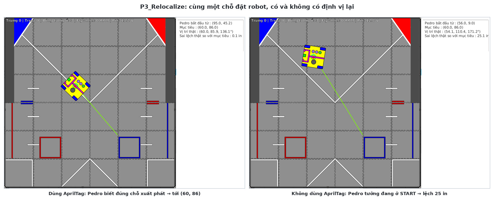

> **Dùng `yaw` hay dùng IMU để biết hướng?** `TagLocalizer.robotPose` lấy hướng từ `yaw`, mà `yaw` nhiễu nhất (ở 100 in,
> độ lệch chuẩn ≈ 2,5°). Sai 1° về hướng ở khoảng cách 100 in làm vị trí lệch ≈ 100 × tan 1° ≈ **1,75 in**. Vì vậy khi
> robot **đã có IMU/odometry**, hãy dùng `TagLocalizer.robotPoseWithHeading(d, headingIMU, ...)`: lấy hướng từ IMU,
> chỉ lấy `range` và `bearing` từ camera. Đây cũng là ý tưởng của MegaTag2 trên Limelight.
>
> Điều kiện là hướng của IMU/odometry phải **đúng**. Nếu chính hướng xuất phát bị khai báo sai (robot đặt lệch 10° mà
> code vẫn tưởng 90°), `robotPoseWithHeading` sẽ tính ra vị trí sai theo. Khi đó chỉ `robotPose`, lấy hướng từ `yaw` và
> trung bình thật nhiều lần đo như ví dụ này, mới sửa được. Thử thách 4 ở Phần 5 dựa trên đúng tình huống đó.

## 3.6 Bài tập Phần 3

**Bài 3.1 (★) — Tính tay `ftcPose`.** Camera thấy một thẻ với `x = −12 in`, `y = 48 in`, `z = 19,5 in`. Tính
`range`, `bearing`, `elevation`. Thẻ nằm bên nào? Robot phải quay về bên nào để ngắm?

<details>
<summary>Lời giải 3.1</summary>

- `range = √(12² + 48²) = √2448 ≈ 49,5 in`
- `bearing = atan2(−x, y) = atan2(12, 48) ≈ +14,0°` → thẻ lệch **trái** (x âm), robot phải quay **trái** 14°.
- `elevation = atan2(z, y) = atan2(19,5; 48) ≈ 22,1°` → tâm thẻ cao hơn camera.

Lưu ý: `elevation` chia cho `y`, không chia cho `range`. Với `range` thì ra 21,5°, sai so với SDK.

</details>

**Bài 3.2 (★) — Đoán dấu.** Robot đứng **trên pháp tuyến** của thẻ và nhìn thẳng vào thẻ (`bearing = 0`, `yaw = 0`).
Giả sử camera nằm đúng tâm quay của robot.
(a) Robot **quay phải 15°** tại chỗ: `bearing` = ? `yaw` = ?
(b) Robot đi ngang sang **trái** một đoạn (theo tay trái của nó) rồi quay lại nhìn thẳng vào thẻ: dấu của `yaw`?
Kiểm chứng bằng `P3_TagTelemetry` (tắt nhiễu bằng B).

<details>
<summary>Lời giải 3.2</summary>

(a) Thẻ trôi sang **trái** ảnh, nên camera phải quay trái 15° để nhìn lại: `bearing = +15°`. Vị trí không đổi nên
α = 0, và `yaw = bearing − α = +15°`.
(b) Nhìn thẳng vào thẻ nên `bearing = 0`. Robot đứng lệch về phía tay trái của nó nên `yaw > 0`. Đây chính là lý do
ví dụ 3.3 dùng `right = +K_STRAFE × yaw`: `yaw` dương thì đi sang phải để về pháp tuyến.

Bài học: **`yaw` thay đổi cả khi robot chỉ quay tại chỗ**. Muốn biết robot lệch bên nào thì phải ngắm cho
`bearing ≈ 0` trước, hoặc dùng `yaw − bearing`.

</details>

**Bài 3.3 (★★) — Chọn goal gần nhất.** Viết TeleOp hiển thị **thẻ goal gần nhất** (chỉ xét ID 20 và 24) cùng
`range` của nó. Thẻ ở xa hơn **120 in** bị coi là không tin cậy: bỏ qua, nhưng đếm số lần bỏ. Không có thẻ hợp lệ thì
in "KHÔNG CÓ".

<details>
<summary>Lời giải 3.3 — <code>solutions/S3_3_NearestGoal.java</code></summary>

```java
SimTagDetection best = null;
int goalsSeen = 0, ignored = 0;
for (SimTagDetection d : camera.getDetections()) {
    boolean isGoal = d.id == SimAprilTagCamera.BLUE_GOAL_ID || d.id == SimAprilTagCamera.RED_GOAL_ID;
    if (!isGoal) continue;                                   // bỏ qua obelisk
    goalsSeen++;
    if (d.ftcPose.range > MAX_TRUSTED_RANGE) { ignored++; continue; }
    if (best == null || d.ftcPose.range < best.ftcPose.range) best = d;
}
if (best == null) telemetry.addData("Goal gần nhất", "KHÔNG CÓ (trong %.0f in)", MAX_TRUSTED_RANGE);
else telemetry.addData("Goal gần nhất", "ID %d (%s) — %.1f in", best.id, best.metadata.name, best.ftcPose.range);
```

Kiểm tra: ở (66, 30) nhìn lên, camera thấy **cả hai** goal, gần nhất là ID 20 (≈ 104 in). Ở (66, 10) nhìn lên, camera vẫn
thấy hai thẻ nhưng cả hai đều > 120 in, nên kết quả là "KHÔNG CÓ" và "bỏ qua: 2". Mẫu "đi qua danh sách, lọc, giữ phần
tử tốt nhất" này dùng rất nhiều trong FTC.

</details>

**Bài 3.4 (★★) — Autonomous tự tìm và ngắm.** Robot bắt đầu ở (60, 40) nhìn sang phải (0°), **chưa thấy thẻ**. Viết
Autonomous: chưa thấy thẻ 20 thì quay trái chậm để **tìm**. Thấy rồi thì **ngắm** cho `bearing → 0`. Dừng khi
`|bearing| < 1°` **liên tục 0,3 s**. Yêu cầu thêm: nếu chỉ mất thẻ trong chốc lát (rớt khung), robot **không** được
quay lại chế độ tìm.

<details>
<summary>Lời giải 3.4 — <code>solutions/S3_4_AutoAim.java</code></summary>

```java
SimTagDetection tag = camera.getDetection(SimAprilTagCamera.BLUE_GOAL_ID);
if (tag != null) lastSeen.reset();

if (tag == null && lastSeen.seconds() > LOST_SEC) {          // mất thẻ > 0,25 s => TÌM
    drive.drive(0, 0, -SEARCH_TURN);                          // âm = quay trái
    inTolerance.reset();
} else if (tag == null) {                                     // rớt 1–2 khung => đứng chờ
    drive.stop();
} else {                                                      // NGẮM
    double rotate = 0;
    if (Math.abs(tag.ftcPose.bearing) > TOLERANCE_DEG) {
        rotate = Range.clip(-K_TURN * tag.ftcPose.bearing, -MAX_TURN, MAX_TURN);
        rotate += Math.signum(rotate) * MIN_TURN;             // lực tối thiểu để thắng ma sát
        inTolerance.reset();
    }
    drive.drive(0, 0, rotate);
    if (inTolerance.seconds() >= STABLE_SEC) done = true;
}
```

Kết quả mô phỏng: tìm thấy thẻ sau khoảng 2,5 s, **xong sau 3,7 s**, sau đó `bearing` chỉ còn dao động dưới 1°.
Hai kỹ thuật đáng nhớ: (1) **"ổn định trong một khoảng thời gian"** thay vì "vừa chạm ngưỡng là dừng", để tránh dừng
khi robot đang lao qua; (2) **dung thứ rớt khung**, để tránh robot giật qua lại khi camera mất thẻ một khung hình.

</details>

**Bài 3.5 (★★★) — Định vị lại trong TeleOp.** Trong TeleOp dùng Pedro, bấm **Y** để sửa vị trí của Pedro bằng thẻ
goal. Để thấy tác dụng, hãy cố tình khởi tạo Pedro **sai (+10, −5) in**, giống odometry bị trôi sau va chạm. Dùng hướng
từ odometry (`robotPoseWithHeading`) cho chính xác.

<details>
<summary>Lời giải 3.5 — <code>solutions/S3_5_RelocalizeTeleOp.java</code></summary>

```java
if (gamepad1.yWasPressed()) {
    SimTagDetection d = camera.getDetection(SimAprilTagCamera.BLUE_GOAL_ID);
    if (d == null) d = camera.getDetection(SimAprilTagCamera.RED_GOAL_ID);
    if (d != null) {
        Pose before = follower.pose();
        double[] e = TagLocalizer.robotPoseWithHeading(d, Math.toDegrees(before.heading()), 8, 0, 0);
        follower.setPose(new Pose(e[0], e[1], before.heading()));     // giữ hướng của odometry
    }
}
```

Mô phỏng: robot ở (70, 60) nhìn 125°. Trước khi bấm Y, sai lệch là **11,2 in**. Sau khi bấm Y, còn **dưới 1 in**
(0,9 in trong lần chạy thử).

</details>

**Bài 3.6 (★★★) — Lọc bù: hòa trộn camera với odometry.** Cách của bài 3.5 "nhảy" ngay về vị trí camera. Nếu lần đo đó
nhiễu, robot nhảy theo nhiễu. Hãy viết phiên bản **tự động, từ từ**:
`pose_mới = pose_odometry + K × (pose_camera − pose_odometry)`, với K = 0,3, cập nhật tối đa 10 lần/giây. Chỉ dùng lần
đo tốt: thẻ goal, `range ≤ 100 in`, robot chạy chậm (< 10 in/s), và kết quả không lệch odometry quá 24 in.

<details>
<summary>Lời giải 3.6 — <code>solutions/S3_6_BlendLocalize.java</code></summary>

```java
if (blend && sinceUpdate.seconds() >= PERIOD_SEC) {                 // tối đa 10 lần/giây
    Pose p = follower.pose();
    Velocity v = follower.velocity();
    double speed = Math.hypot(v.vx, v.vy);
    SimTagDetection good = null;
    for (SimTagDetection d : camera.getDetections()) {
        boolean isGoal = d.id == SimAprilTagCamera.BLUE_GOAL_ID || d.id == SimAprilTagCamera.RED_GOAL_ID;
        if (!isGoal) continue;
        if (d.ftcPose.range > MAX_RANGE || speed > MAX_SPEED) { rejected++; continue; }
        if (good == null || d.ftcPose.range < good.ftcPose.range) good = d;
    }
    if (good != null) {
        double[] e = TagLocalizer.robotPoseWithHeading(good, Math.toDegrees(p.heading()), CAM_FWD, CAM_LEFT, CAM_YAW);
        if (Math.hypot(e[0] - p.x(), e[1] - p.y()) > MAX_JUMP) rejected++;         // nghi ngờ đọc sai
        else {
            follower.setX(p.x() + K_BLEND * (e[0] - p.x()));
            follower.setY(p.y() + K_BLEND * (e[1] - p.y()));
            used++;
        }
    }
    sinceUpdate.reset();
}
```

Mô phỏng (sai lệch ban đầu 11,2 in): sau 0,15 s còn **5,5 in**, sau 0,65 s còn **≈ 1 in**, sau 2,65 s còn
**≈ 0,1 in**, và không "giật". So sánh:

| | Nhảy ngay (bài 3.5) | Lọc bù (bài 3.6) |
|---|---|---|
| Tốc độ sửa | tức thì | vài phần mười giây |
| Ảnh hưởng của một lần đo nhiễu | nhảy theo hoàn toàn | chỉ bị kéo 30% |
| Đọc sai hoàn toàn (ví dụ nhầm thẻ) | robot "dịch chuyển tức thời" | bị loại nhờ ngưỡng 24 in |
| Dùng khi | robot đứng yên, cần sửa một lần (đầu trận, trước khi bắn) | chạy liên tục trong TeleOp/Autonomous |

Bộ lọc Kalman mà các đội mạnh dùng chính là phiên bản "thông minh" của ý tưởng này: K tự điều chỉnh theo độ tin cậy
của từng lần đo.

</details>

---

# Phần 4 — Flywheel Shooter

> **Mục tiêu:** hiểu vật lý bánh đà và quỹ đạo bóng. Điều khiển **tốc độ** flywheel bằng 4 cách (hở, PIDF có sẵn của
> Hub, feedforward + P tự viết, bang-bang). Viết máy trạng thái bắn và lập bảng tra "khoảng cách → RPM".
> **Cấu hình:** **Shooter Bot**.
> **Sách:** ch. 7 (`RunMode`, `getVelocity`), ch. 12 (máy trạng thái), ch. 24 (điều khiển hở/kín, bang-bang, P,
> PIDF, PIDF có sẵn).
> **Dựa trên:** Phần 1 (encoder, `getVelocity`, đổi tick/s ↔ RPM, điều khiển P, servo + `ElapsedTime`), Phần 3
> (`range` tới thẻ goal). **Dùng lại ở:** Phần 5 (lớp `Shooter`, bảng tra).

Phần 3 cho biết goal cách bao xa. Phần này trả lời câu hỏi tiếp theo: ở khoảng cách đó flywheel phải quay nhanh bao
nhiêu, và làm sao **giữ đúng** tốc độ ấy khi pin yếu dần và mỗi quả bóng bay đi lại "lấy mất" một phần năng lượng của
bánh? Câu trả lời dùng lại gần như mọi thứ của Phần 1: encoder đo tốc độ, đổi đơn vị, vòng điều khiển P và máy trạng
thái.

## 4.1 Vật lý của flywheel

### 4.1.1 Từ tốc độ bánh tới tốc độ bóng

Flywheel là một bánh khá nặng quay rất nhanh. Shooter Bot dùng kiểu **1 bánh + hood** (nắp cong): quả bóng bị kẹp giữa
mặt bánh đang quay và hood đứng yên nên **lăn** dọc hood. Tâm quả bóng chỉ đi với khoảng **một nửa** tốc độ mặt bánh.
Kiểu 2 bánh quay ngược chiều kẹp bóng ở giữa thì bóng đi gần bằng tốc độ mặt bánh.

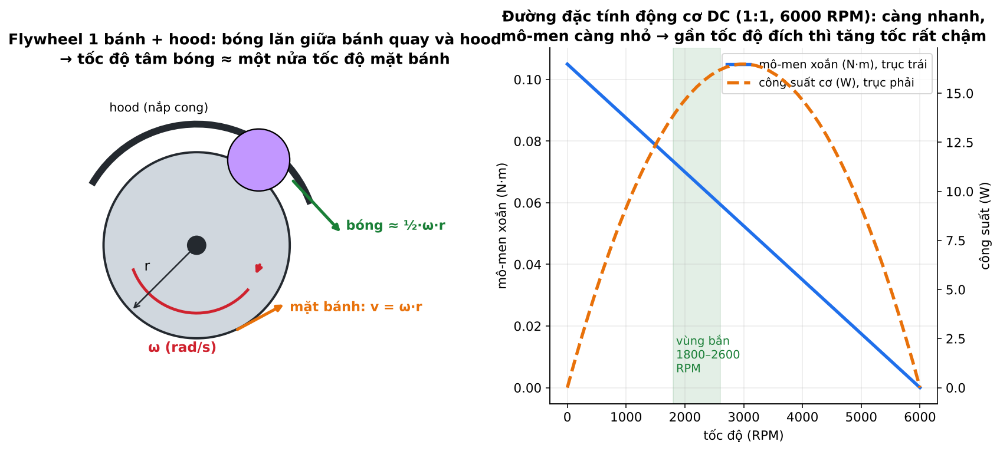

| Đại lượng | Công thức | Ví dụ: 2200 RPM, bánh r = 48 mm, motor 28 tick/vòng |
|---|---|---|
| vận tốc encoder | `tick/s = RPM × 28 / 60` | 1026,7 tick/s (đây là số đưa vào `setVelocity`, bài 1.1 d) |
| vận tốc góc | `ω = RPM × 2π / 60` | 230,4 rad/s |
| tốc độ mặt bánh | `v = ω × r` | 11,06 m/s |
| tốc độ bóng | `v_bóng ≈ η × ω × r`, η ≈ 0,5 với kiểu 1 bánh + hood | ≈ 5,53 m/s |

### 4.1.2 Năng lượng: vì sao bắn xong thì bánh "tụt tốc"?

Bánh đà tích năng lượng `E = ½·J·ω²` (J là mô-men quán tính). Mỗi quả bóng bay đi mang theo một phần năng lượng đó.
Với Shooter Bot (J = 1,5·10⁻⁴ kg·m², bóng 75 g):

- Ở 2200 RPM: `E = ½ × 1,5·10⁻⁴ × 230,4² ≈ 3,98 J`.
- Bóng nhận `½ × 0,075 × 5,53² ≈ 1,15 J`. Cộng hao hụt do nén và trượt bóng (≈ 30%), bánh mất ≈ **1,49 J**.
- Còn lại 2,49 J → `ω' = √(2E'/J) ≈ 182 rad/s ≈` **1740 RPM**, tức còn ≈ 79% tốc độ ban đầu. Mô phỏng đo được
  1730–1770 RPM.
- Tỉ lệ ≈ 79% này **không phụ thuộc tốc độ**: năng lượng của bánh và năng lượng bóng lấy đi đều tỉ lệ với ω², nên ở
  1945 RPM bánh cũng tụt còn khoảng 1540 RPM.

Hệ quả thiết kế: bánh **nặng hơn** (J lớn) thì tụt ít hơn sau mỗi phát, nhưng **lên tốc chậm hơn**. Bánh nhẹ thì ngược
lại. Đồ thị bên phải hình trên cho thấy mô-men của motor giảm dần khi tốc độ tăng. Càng gần tốc độ đích, bánh tăng tốc
càng chậm, nên nếu chỉ "đặt công suất rồi chờ" thì phải chờ rất lâu (mục 4.3).

### 4.1.3 Pin ảnh hưởng thế nào?

`setPower(p)` thực chất cấp khoảng `p × điện áp pin` cho motor. Pin đầy (13,6 V) và pin yếu (12,0 V) cho tốc độ khác nhau
dù cùng một lệnh. Với Shooter Bot, `setPower(0.40)` cho khoảng **2140 RPM ở 12,0 V** nhưng **2440 RPM ở 13,6 V**, chênh
14%. Mô phỏng chọn điện áp pin **ngẫu nhiên 12,0–13,6 V** mỗi lần chạy để bạn gặp đúng vấn đề này.

## 4.2 Bóng bay: ném xiên và bảng tra

Bỏ qua sức cản không khí, quả bóng rời nòng ở độ cao `h0`, góc `θ`, tốc độ `v` sẽ bay theo parabol:

```
y(x) = h0 + x·tanθ − g·x² / (2·v²·cos²θ)
```

Muốn bóng đi qua miệng goal (cách `d`, cao `h`) thì cần tốc độ:

```
v = √( g·d² / (2·cos²θ·(d·tanθ − (h − h0))) )        (chỉ có nghiệm khi d·tanθ > h − h0)
```

Shooter Bot có hood cố định **θ = 55°**, bóng rời nòng ở **h0 = 0,30 m**, miệng goal giả định cao **h = 1,0 m**:

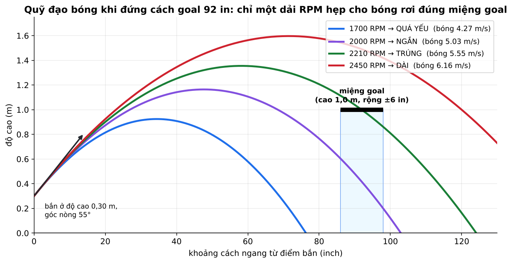

Mô phỏng chấm **TRÚNG** khi bóng đi xuống qua độ cao 1,0 m trong khoảng **±0,15 m (≈ ±6 in)** quanh tâm miệng goal theo
chiều sâu, và lệch ngang không quá **±0,18 m (≈ ±7 in)**. Từ đó tính được **cửa sổ RPM trúng**:

| Khoảng cách từ điểm bóng rời nòng tới tâm goal | RPM trúng | Độ rộng |
|---|---|---|
| 61 in | 1890–1989 | ±50 RPM |
| 72 in | 1980–2085 | ±52 RPM |
| 92 in | 2159–2262 | ±51 RPM |

Chỉ sai khoảng **±50 RPM (±2,3%)** là trượt. Vì vậy flywheel bắt buộc phải điều khiển **vòng kín**, và lớp `Shooter`
chỉ cho đẩy bóng khi `|RPM − mục tiêu| ≤ 50`.

Còn một giới hạn dưới: chậm hơn khoảng **1800 RPM** thì đỉnh quỹ đạo thấp hơn 1,0 m, bóng không bao giờ lên tới miệng
goal (mô phỏng chấm **QUÁ YẾU**). Với hood cố định 55°, tốc độ tối thiểu đó đã đưa bóng bay xa khoảng 35–40 in, nên
đứng sát goal hơn thế thì không bắn trúng được.

**Vì sao vẫn dùng bảng tra mà không chỉ dùng công thức?** Bóng thật chịu sức cản, có xoáy, bị nén. Hệ số η và góc
rời nòng thật không ai biết chính xác. Công thức cho biết **hình dạng** của quan hệ, còn **con số** phải đo bằng cách bắn
thử. Cách làm của các đội: đứng ở 6–10 khoảng cách, mỗi chỗ dò ra cửa sổ RPM trúng, lấy **điểm giữa**, ghi vào bảng.
Khi thi đấu, chương trình **nội suy tuyến tính** giữa hai điểm gần nhất:

```java
InterpLUT table = new InterpLUT()          // khoảng cách camera → thẻ goal (in)  →  RPM
        .add(55, 1945).add(65, 2030).add(75, 2120).add(85, 2210);   // ... (ShooterTable có 11 điểm, 35–135 in)
double rpm = table.get(70);                // 2030 + (70−65)/(75−65) × (2120−2030) = 2075
```

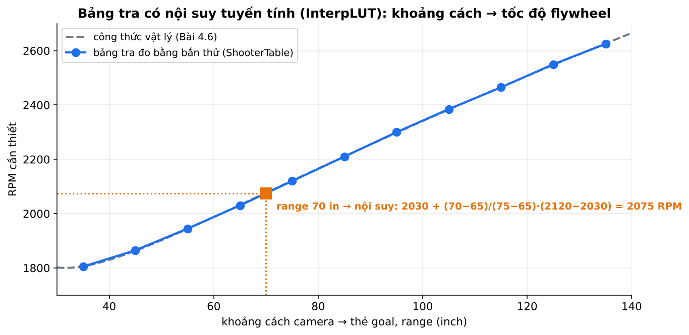

`InterpLUT` **kẹp** (clamp) giá trị ngoài khoảng đo: đứng xa hơn điểm xa nhất thì dùng RPM của điểm xa nhất, **không
ngoại suy**. Ngoại suy từ dữ liệu đo là cách nhanh nhất để bắn trượt. Điểm gần nhất của bảng (35 in → 1805 RPM) cũng
nằm sát giới hạn 1800 RPM ở trên.

## 4.3 Bốn cách điều khiển tốc độ flywheel

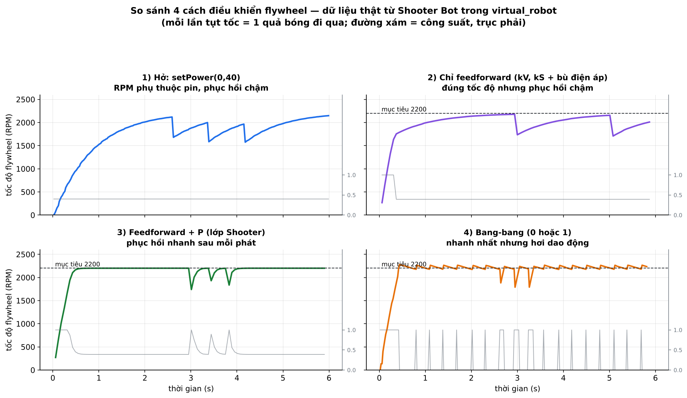

### Cách 1 — Điều khiển hở: `setPower`

```java
flywheel.setMode(DcMotor.RunMode.RUN_WITHOUT_ENCODER);
flywheel.setZeroPowerBehavior(DcMotor.ZeroPowerBehavior.FLOAT);   // tắt máy thì bánh quay trơn, không phanh gấp
flywheel.setPower(0.40);
```

Đơn giản nhất nhưng có hai nhược điểm lớn. Tốc độ **phụ thuộc pin** (mục 4.1.3). Sau mỗi phát, bánh hồi phục **rất
chậm** (hơn 1,5 giây) vì chỉ dựa vào đặc tính tự nhiên của motor. Ở góc trên-trái hình: 3 phát liên tiếp mỗi phát yếu dần.

### Cách 2 — Bộ PIDF vận tốc có sẵn trong Hub

```java
flywheel.setMode(DcMotor.RunMode.RUN_USING_ENCODER);
flywheel.setPIDFCoefficients(DcMotor.RunMode.RUN_USING_ENCODER,
        new PIDFCoefficients(10, 1, 0, 11.7));            // thứ tự: P, I, D, F  (sách Listing 24.7 viết nhầm thứ tự!)
flywheel.setVelocity(targetRpm * 28 / 60.0);               // đơn vị: tick/giây
```

Hub tự chạy vòng điều khiển, không phụ thuộc tốc độ vòng lặp OpMode. Hệ số **F nhân với vận tốc mục tiêu**: đó là phần
"đoán trước" công suất cần thiết. **Công thức khởi đầu** hay dùng (theo tài liệu của REV Robotics):

1. Cho motor chạy `setPower(1)` (RUN_WITHOUT_ENCODER), đọc `getVelocity()` lúc ổn định → `maxTPS`.
2. `F = 32767 / maxTPS`. Với motor 6000 RPM (28 tick/vòng) lý thuyết là 2800 tick/s → F ≈ 11,7.
3. `P = 0,1 × F`, `I = 0,1 × P`, `D = 0`.
4. Bắn thử. Phục hồi chậm thì **tăng P**. Còn sai số lâu dài thì **tăng I một chút**. I quá lớn sẽ vọt lố sau mỗi
   phát (*integral windup*).

Kết quả đo trong `P4_FlywheelVelocity`, mục tiêu 2200 RPM, mỗi bộ chạy từ lúc bánh đứng yên. **Lên tốc** tính từ START
tới lần đầu vào ±3% mục tiêu. **Phục hồi** tính từ lúc bóng bay đi tới khi tốc độ về lại ±3%:

| Bộ hệ số (P, I, D, F) | Lên tốc 0 → 2200 RPM | Sai số khi ổn định | Phục hồi sau 1 phát |
|---|---|---|---|
| Mặc định của flywheel Shooter Bot (10, 3, 0, 0) | ≈ 1,2 s | thiếu 15–20 RPM, vài giây sau I mới bù hết | ≈ 0,12 s |
| Theo công thức (1,17; 0,12; 0; 11,7) | ≈ 0,9–1,1 s | vượt 10–45 RPM (tùy pin) | ≈ 0,4–0,5 s |
| **Đã chỉnh** (10; 1; 0; 11,7) | **≈ 0,4 s** | **≈ 0–3 RPM** | **≈ 0,1 s** |

Bộ mặc định không có F: toàn bộ công suất phải do P và I "gồng" lên, nên lên tốc chậm và lúc đầu luôn thiếu một chút.
Bộ theo công thức có F nhưng P quá nhỏ, nên phục hồi chậm và kết quả thay đổi theo pin. Bộ đã chỉnh giữ F và tăng P:
P lớn tự bù phần chênh lệch do pin, nên hai lần chạy với hai mức pin khác nhau cho kết quả gần như nhau.

> virtual_robot chỉ mô phỏng **gần đúng** bộ PIDF của Hub. Trên robot thật, hãy đọc bộ hệ số mặc định của motor bằng
> `getPIDFCoefficients(DcMotor.RunMode.RUN_USING_ENCODER)` (mỗi loại motor có thể khác), rồi chỉnh lại theo đúng quy
> trình trên. Hàm `setVelocityPIDFCoefficients(p, i, d, f)` là cách viết khác của cùng việc này.

### Cách 3 — Tự viết: feedforward + P + bù điện áp (lớp `Shooter`)

```java
double targetTps = targetRpm * 28 / 60.0;
double feedforward = (kV * targetTps + kS) * (12.0 / battery.getVoltage());   // "đoán trước" + bù pin
double feedback = kP * (targetTps - motor.getVelocity());                      // sửa phần còn thiếu
motor.setPower(Math.max(0, Math.min(1, feedforward + feedback)));              // flywheel chỉ quay một chiều
```

- **kV** (công suất cho mỗi tick/s) và **kS** (công suất để thắng ma sát) **đo được** bằng thí nghiệm hở (bài 4.2).
  Shooter Bot: kV = 0,000382, kS = 0,019, đo ở 12 V.
- Nhân với `12 / điện áp pin` để pin mạnh hay yếu cũng cho cùng tốc độ. Đây là thứ bộ PIDF của Hub không tự làm.
- **kP** chỉ còn phải sửa phần sai số nhỏ và kéo tốc độ lên nhanh sau mỗi phát. Tăng dần tới khi hồi phục nhanh mà
  không dao động. Shooter Bot: kP = 0,004.
- **So với sách (ch. 24.5.2):** "F" trong sách là một **hằng số** (giữ cánh tay hay thanh trượt chống trọng lực).
  Với flywheel, công suất cần thiết **tỉ lệ với tốc độ** nên feedforward phải là `kV × vận tốc + kS`.
- Ưu điểm: thấy và ghi lại được mọi thứ (telemetry, CSV), có bù pin. Sách (ch. 24.5.4) cũng nhận xét bộ điều khiển tự
  viết thường **phản ứng nhanh hơn** bộ có sẵn trong Hub. Nhược điểm: phải gọi `update()` **mỗi vòng lặp**, và vòng lặp
  phải nhanh (không dùng `sleep` dài).

Hình trên, ô 2 (chỉ feedforward) và ô 3 (feedforward + P): tốc độ ổn định gần như nhau, nhưng có P thì hồi phục
nhanh gấp khoảng 10 lần (≈ 0,15 s so với ≈ 1,7 s).

### Cách 4 — Bang-bang (sách ch. 24.3)

```java
if (rpm < target - DEADBAND) power = 1.0;          // thiếu tốc → hết cỡ
else if (rpm > target + DEADBAND) power = 0.0;     // thừa tốc → thả trôi (KHÔNG đảo chiều!)
// ở giữa vùng chết: giữ nguyên công suất cũ (hysteresis, sách mục 24.3.1)
```

Bang-bang hồi phục **nhanh nhất** vì luôn đạp hết ga khi thiếu tốc. Đổi lại, tốc độ luôn dao động (khoảng 2175–2265 RPM),
motor và pin bị "giật" liên tục, và có tiếng ồn. Một số đội kết hợp: bang-bang khi còn xa mục tiêu, feedforward + P khi
đã gần.

**Tổng kết (dữ liệu thật từ Shooter Bot, mục tiêu 2200 RPM):**

| Cách | Lên tốc (±3%) | Phục hồi sau 1 phát | Khi ổn định | Dùng khi |
|---|---|---|---|---|
| 1. Hở `setPower(0.40)` | > 5 s, đích phụ thuộc pin | > 1,5 s | 2140–2440 RPM tùy pin | chỉ để thí nghiệm |
| 2. PIDF của Hub (đã chỉnh) | ≈ 0,4 s | ≈ 0,1 s | sai ≈ 0 | muốn ít code |
| 3a. Chỉ feedforward | ≈ 2,0 s | ≈ 1,7 s | thiếu ≈ 20 RPM | bước trung gian khi chỉnh |
| 3b. Feedforward + P (`Shooter`) | ≈ 0,5 s | ≈ 0,15 s | đúng 2200 | **lựa chọn của tài liệu** |
| 4. Bang-bang | ≈ 0,4 s | < 0,1 s | dao động 2175–2265 RPM | cần bắn liên thanh rất nhanh |

Trong mô phỏng, PIDF của Hub (đã chỉnh) và lớp `Shooter` cho kết quả gần như nhau. Tài liệu vẫn chọn `Shooter` vì có
bù điện áp pin, thấy và ghi lại được mọi con số, hiểu được từng dòng nên dễ chỉnh, và trên Hub thật bộ tự viết thường
phản ứng nhanh hơn (nhận xét của sách ở cách 3). Nếu muốn ít code, PIDF của Hub vẫn là lựa chọn tốt.

## 4.4 Máy trạng thái bắn

Bắn 3 quả không phải là "đẩy servo 3 lần". Sau mỗi phát bánh tụt còn ≈ 79% tốc độ (mục 4.1.2), tức mất 400–460 RPM
ở 1900–2200 RPM. Nếu đẩy quả tiếp theo ngay, quả đó chắc chắn **ngắn** hoặc **quá yếu**. Lớp `Shooter` dùng một máy
trạng thái (sách ch. 12):

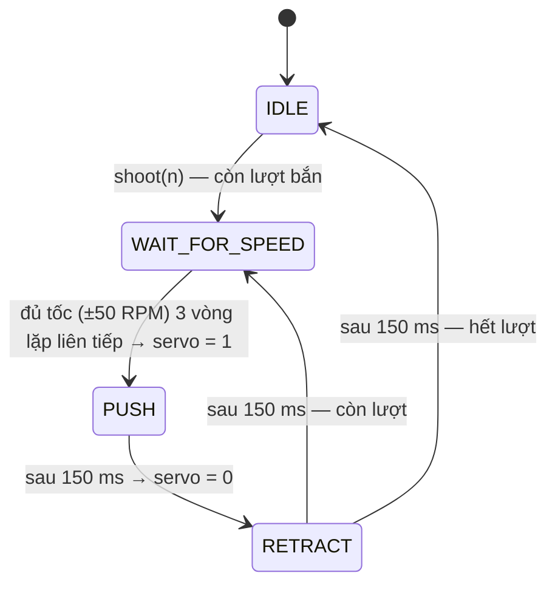

```java
case WAIT_FOR_SPEED:
    stableCount = atSpeed() ? stableCount + 1 : 0;      // phải "đủ tốc" liên tiếp, không chỉ chạm ngưỡng 1 lần
    if (stableCount >= STABLE_LOOPS) { feeder.setPosition(1); timer.reset(); state = State.PUSH; }
    break;
case PUSH:
    if (timer.milliseconds() >= PUSH_MS) { feeder.setPosition(0); timer.reset(); state = State.RETRACT; }
    break;
```

Dùng trong OpMode chỉ cần vài dòng. Toàn bộ thời gian chờ đều nằm trong máy trạng thái, **không có `sleep()`**, nên robot
vẫn lái, vẫn ngắm được trong lúc bắn:

```java
shooter.setTargetRpm(table.get(range));
shooter.shoot(3);
// mỗi vòng lặp:
shooter.update();
```

## 4.5 Luật chơi của Shooter Bot trong mô phỏng

- **Servo đẩy** `feeder_servo`: phải ở vị trí `1` **≥ 100 ms** thì bóng mới bay, rồi về `0` **≥ 100 ms** mới đẩy được
  quả tiếp. Lớp `Shooter` dùng 150 ms / 150 ms cho chắc.
- **Ổ chứa** tối đa 3 bóng. Sau mỗi lần STOP, ổ tự nạp lại đủ 2 tím + 1 xanh lá, thứ tự ngẫu nhiên. Nút *Preload
  Elements* nạp lại khi chưa INIT. Cảm biến `ball_sensor` thấy màu quả **kế tiếp** (khoảng cách 2,5 cm nếu có bóng,
  15 cm nếu trống).
- **Intake** `intake_motor` (công suất > 0,3): chỉ nạp được khi tâm robot nằm trong **vùng nạp**, là 2 ô 24 × 24 in ở góc
  dưới-trái và góc dưới-phải. Mỗi 0,4 s được 1 bóng (1/3 là xanh lá).
- **Chấm điểm:** lúc bóng bay, bot lấy **tốc độ flywheel thật** (cộng nhiễu 0,5%), tính quỹ đạo, chọn goal gần hướng bắn
  nhất rồi ghi lên sân và vào cửa sổ Run: **TRÚNG!**, **NGẮN x in**, **DÀI x in**, **LỆCH TRÁI/PHẢI x in**, **QUÁ YẾU**
  (không lên tới 1,0 m). Dòng trạng thái góc trên sân đếm số phát trúng/trượt, số bóng, RPM và điện áp pin.
- **Pin:** mỗi lần chạy một điện áp ngẫu nhiên 12,0–13,6 V. Bộ điều khiển tốt phải cho cùng kết quả với mọi mức pin.

## 4.6 Ví dụ

### Ví dụ 4.1 — `P4_FlywheelOpenLoop`: điều khiển hở

dpad ↑/↓ đổi công suất ±0,05, A đẩy 1 bóng, B bật/tắt flywheel, X đổi BRAKE/FLOAT. Đặt robot ở (60, 86) nhìn 136°,
tức vị trí SHOOT của Phần 2. Một lần chạy mẫu (pin 12,57 V): công suất 0,40 → sau 3,5 s được **2213 RPM** và vẫn còn
tăng chậm. Bắn 1 quả: tụt còn khoảng 1750 RPM, 1 giây sau mới hồi được **2102 RPM**. Quả đó bay **DÀI 31 in**, vì ở
khoảng cách này chỉ cần ≈ 1940 RPM (mục 4.2).

Telemetry còn in một "ước lượng thô" `0,40 × 6000 × V/12 ≈ 2514 RPM`. Tốc độ thật thấp hơn khá nhiều vì ước lượng thô
bỏ qua ma sát và đường đặc tính của motor (hình 41). Đó là lý do kV, kS phải **đo**, không suy từ thông số motor.

**Thí nghiệm:** STOP rồi INIT lại 3–4 lần với cùng công suất 0,40. Mỗi lần pin một khác, nên RPM và điểm rơi cũng khác.
Đây chính là lý do phải điều khiển vòng kín.

### Ví dụ 4.2 — `P4_FlywheelVelocity`: PIDF có sẵn

Trong lúc **INIT**, bấm **X** (mặc định), **B** (theo công thức) hoặc **Y** (đã chỉnh) để chọn bộ hệ số, rồi START.
Mục tiêu 2200 RPM (dpad ±100). Telemetry ghi thời gian **lên tốc** (từ START tới ±3%). Bấm **A** để bắn, telemetry ghi
tốc độ thấp nhất sau phát bắn và thời gian **phục hồi** (từ lúc bóng bay tới khi về lại ±3%). Ví dụ này chỉ quan tâm
tốc độ, nên robot đứng đâu cũng được, bóng trượt cũng không sao. Kết quả ở bảng mục 4.3, cách 2. Hãy chọn bộ hệ số
**trước khi START**: nếu đổi giữa chừng, phần tích phân cũ vẫn còn và làm kết quả sai lệch.

### Ví dụ 4.3 — `P4_FlywheelCustom`: lớp `Shooter`, xuất dữ liệu ra CSV

A bắn 1, B bắn 3 (máy trạng thái), dpad ±100 RPM, **X tắt/bật phần P**, **Y tắt/bật bù điện áp**. Mỗi 50 ms OpMode in một
dòng `t,target,rpm,power` bằng `System.out.printf`. Các dòng này hiện ở cửa sổ **Run** của Android Studio. Chép vào
Excel/Google Sheets để vẽ đồ thị như hình 42. Đây là cách các đội chỉnh hệ số trên robot thật.

```java
if (clock.seconds() - lastLog >= 0.05) {
    lastLog = clock.seconds();
    System.out.printf("%.2f,%.0f,%.0f,%.3f%n", lastLog, shooter.getTargetRpm(), shooter.getRpm(), shooter.getLastPower());
}
```

### Ví dụ 4.4 — `P4_ShootThree`: camera → bảng tra → bắn 3 quả

```java
double sum = 0; int n = 0;                                   // 1) đo khoảng cách: trung bình 10 lần
while (opModeIsActive() && n < 10 && t.seconds() < 2) {
    SimTagDetection d = camera.getDetection(SimAprilTagCamera.BLUE_GOAL_ID);
    if (d != null) { sum += d.ftcPose.range; n++; }
    sleep(30);
}
double range = n > 0 ? sum / n : 60;                         // không thấy thẻ → giá trị dự phòng
shooter.setTargetRpm(table.get(range));                      // 2) tra bảng
shooter.shoot(3);                                            // 3) bắn 3, chờ đủ tốc trước mỗi quả
while (opModeIsActive() && shooter.isBusy()) shooter.update();
```

Kết quả: ở (60, 86) nhìn 136,2° → range ≈ 54 in → **1937 RPM** → **3/3 TRÚNG**. Ở (80,7; 63,3) nhìn 135° → range
≈ 85 in → **≈ 2210 RPM** → **3/3 TRÚNG** (ảnh phải bên dưới). Cùng một chương trình, hai khoảng cách, hai tốc độ khác
nhau: bảng tra làm đúng việc của nó.

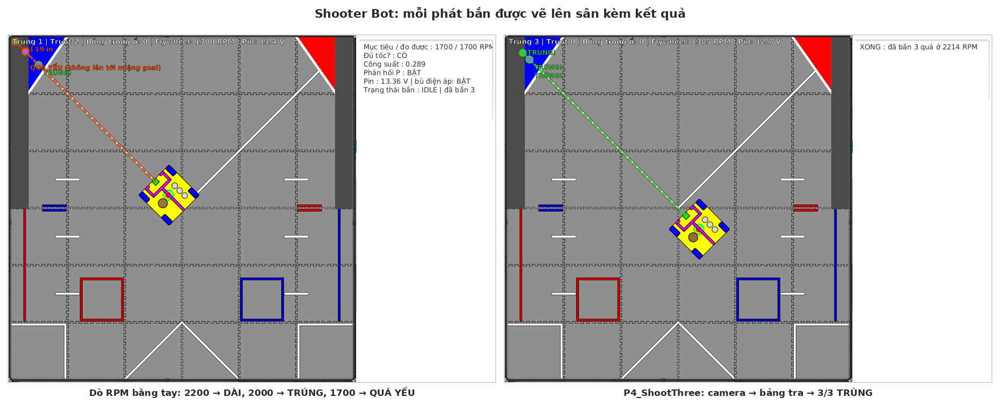

### Ví dụ 4.5 — `P4_TeleOpShooter`: TeleOp hoàn chỉnh

| Nút | Chức năng |
|---|---|
| cần trái / cần phải | lái mecanum (sách ch. 20) |
| **LB** (giữ) | tự ngắm goal xanh: `rotate = −0,015 × bearing` (Phần 3) |
| **RT** (bóp > 50%) | quay flywheel, RPM **tự tra bảng** theo `range` của camera |
| **A** / **B** | bắn 1 / bắn 3 |
| **RB** (giữ) | bật intake (chỉ nạp được trong vùng nạp) |

Telemetry hiện màu quả bóng kế tiếp (lớp `ColorUtil`, phân loại theo sắc độ như mục 1.1.4) và chữ **SẴN SÀNG** khi
flywheel đã đủ tốc. Người lái chỉ cần đưa robot vào vùng bắn, giữ LB, bóp RT, chờ SẴN SÀNG rồi bấm B. Thử: đặt robot ở
(80, 63) nhìn 120°, giữ LB khoảng 1,5 s, bóp RT rồi bấm B → **3/3 TRÚNG** (range ≈ 84 in, ≈ 2205 RPM).

So với bài 2.5 (khóa hướng theo tọa độ odometry), LB ở đây ngắm theo **camera**: odometry có trôi thì robot vẫn nhìn
đúng goal.

## 4.7 Bài tập Phần 4

**Bài 4.1 (★) — Đổi đơn vị và năng lượng.** Flywheel 1:1 (28 tick/vòng), bánh bán kính 48 mm, kiểu 1 bánh + hood.
(a) 2200 RPM bằng bao nhiêu tick/s? rad/s? (b) Tốc độ mặt bánh và tốc độ bóng? (c) Với J = 1,5·10⁻⁴ kg·m², bóng 75 g,
hao hụt 30%, ước lượng RPM ngay sau khi bắn.

<details>
<summary>Lời giải 4.1</summary>

(a) `2200 × 28 / 60 = 1026,7 tick/s`. `ω = 2200 × 2π / 60 = 230,4 rad/s`.
(b) `v_mặt = 230,4 × 0,048 = 11,06 m/s`. `v_bóng ≈ 0,5 × 11,06 ≈ 5,53 m/s`.
(c) `E = ½ × 1,5·10⁻⁴ × 230,4² = 3,98 J`. Bóng lấy `½ × 0,075 × 5,53² × 1,3 = 1,49 J`. Còn 2,49 J →
`ω' = √(2 × 2,49 / 1,5·10⁻⁴) ≈ 182 rad/s ≈ 1740 RPM`. Mô phỏng đo được 1730–1770 RPM.

</details>

**Bài 4.2 (★★) — Đo kV và kS.** Dùng `P4_FlywheelOpenLoop` (hoặc tự viết OpMode): chạy hở ở 3 mức công suất, chờ 4 giây
cho ổn định rồi ghi tốc độ (tick/s) và điện áp pin. Một bạn đo được ở pin **12,16 V**:

| Công suất | 0,30 | 0,50 | 0,70 |
|---|---|---|---|
| Tốc độ (tick/s) | 741 | 1272 | 1803 |

Tìm `kV`, `kS` sao cho `công suất (quy về 12 V) = kV × tick/s + kS`.

<details>
<summary>Lời giải 4.2</summary>

Quy công suất về 12 V: nhân với `12,16 / 12 = 1,0133` → 0,304; 0,507; 0,709.
Đường thẳng qua các điểm: `kV = (0,709 − 0,304) / (1803 − 741) ≈ 0,000381`, `kS = 0,304 − 0,000381 × 741 ≈ 0,021`.
Giá trị trong lớp `Shooter`: kV = 0,000382, kS = 0,019, rất sát. Với nhiều điểm đo hơn, dùng hồi quy tuyến tính
(Excel: hàm `SLOPE` và `INTERCEPT`).

Vì sao phải "quy về 12 V"? Cùng công suất 0,5 nhưng pin 13,5 V sẽ cho tốc độ cao hơn. Nếu không quy đổi, kV đo hôm pin
đầy sẽ sai vào hôm pin yếu.

</details>

**Bài 4.3 (★★) — Bang-bang.** Viết OpMode điều khiển flywheel bằng bang-bang có vùng chết ±20 RPM quanh 2200 RPM.
Tự bắn 3 quả ở giây thứ 2,5 (mỗi quả chỉ khi đủ tốc) và in CSV để so sánh với `P4_FlywheelCustom`. Bài này chỉ so
sánh tốc độ, robot đứng đâu cũng được.

<details>
<summary>Lời giải 4.3 — <code>solutions/S4_3_BangBang.java</code></summary>

```java
double rpm = flywheel.getVelocity() * 60 / 28.0;
if (rpm < TARGET_RPM - DEADBAND_RPM) power = 1.0;
else if (rpm > TARGET_RPM + DEADBAND_RPM) power = 0.0;       // không bao giờ đảo chiều flywheel
flywheel.setPower(power);                                      // giữa vùng chết: giữ công suất cũ
```

Kết quả (ô 4 của hình 42): lên tốc ≈ 0,42 s, hồi phục dưới 0,1 s sau mỗi phát (nhanh nhất), nhưng tốc độ dao động
khoảng 2175–2265 RPM. Vì sao vượt lên tới +65 dù vùng chết chỉ ±20? Vì vòng lặp có độ trễ (~20 ms) và bánh có quán
tính: khi code kịp nhận ra "thừa tốc" và cắt điện thì bánh đã vượt qua ngưỡng.

</details>

**Bài 4.4 (★★) — Tự lập một dòng bảng tra.** Đặt Shooter Bot ở **(66,6; 77,4)** nhìn **135°** (camera thấy thẻ 20 ở
`range ≈ 65 in`). Dùng `P4_FlywheelCustom`, dò RPM tới khi bắn trúng. Tìm cả **cửa sổ** RPM trúng rồi chọn giá trị cho
bảng tra.

<details>
<summary>Lời giải 4.4</summary>

Dò thô: **2200 → DÀI 19 in**, **2000 → TRÚNG**, **1700 → QUÁ YẾU** (ảnh trái ở ví dụ 4.4). Dò mịn từng 25 RPM quanh 2000
để tìm hai mép: trúng từ ≈ **1980** tới ≈ **2085 RPM**. Lấy **điểm giữa ≈ 2030 RPM** → dòng bảng tra `(65, 2030)`.
Chọn điểm giữa để pin, nhiễu và sai số nhỏ của bộ điều khiển không đẩy phát bắn ra ngoài cửa sổ.

Mẹo dò: dùng **tìm kiếm nhị phân**. Ngắn thì tăng, dài thì giảm, mỗi lần giảm bước một nửa. Ghi lại mọi phát bắn vào
bảng tính, kể cả phát trượt.

</details>

**Bài 4.5 (★) — "Đủ tốc" theo thời gian.** `Shooter` coi là đủ tốc khi đạt ±50 RPM **3 vòng lặp liên tiếp**. Nếu vòng lặp
lúc nhanh lúc chậm thì "3 vòng" là bao lâu? Viết hàm `readyToShoot()` yêu cầu tốc độ nằm trong ±50 RPM **liên tục
100 ms**, dùng `ElapsedTime`.

<details>
<summary>Lời giải 4.5</summary>

```java
private final ElapsedTime inBandTimer = new ElapsedTime();
private boolean wasInBand = false;

public boolean readyToShoot() {
    boolean inBand = targetRpm > 0 && Math.abs(getRpm() - targetRpm) <= TOLERANCE_RPM;
    if (inBand && !wasInBand) inBandTimer.reset();     // vừa lọt vào vùng → bắt đầu bấm giờ
    wasInBand = inBand;
    return inBand && inBandTimer.milliseconds() >= 100;
}
```

Trong `WAIT_FOR_SPEED`, thay điều kiện `stableCount >= STABLE_LOOPS` bằng `readyToShoot()`. Vòng lặp 5 ms hay 30 ms
thì yêu cầu vẫn là 100 ms. Quy tắc chung: **điều kiện về thời gian thì đo bằng đồng hồ, không đếm vòng lặp**.

</details>

**Bài 4.6 (★★★) — Bắn bằng vật lý.** Thay bảng tra bằng công thức ném xiên: từ camera tính vị trí robot (Phần 3), suy ra
điểm bóng rời nòng (8 in trước tâm robot), tính khoảng cách tới tâm goal (10, 134), rồi tính RPM bằng
`v = √(g·d² / (2cos²θ·(d·tanθ − Δh)))` và `RPM = v / (η·r) × 60 / 2π`. In ra để so sánh với bảng tra, rồi bắn 3 quả.

<details>
<summary>Lời giải 4.6 — <code>util/ShooterPhysics.java</code> + <code>solutions/S4_6_PhysicsShot.java</code></summary>

```java
public static double requiredRpm(double distanceIn) {
    double d = distanceIn * 0.0254, th = Math.toRadians(THETA_DEG);
    double denom = 2 * Math.cos(th) * Math.cos(th) * (d * Math.tan(th) - (H_GOAL - H0));
    if (denom <= 0) return Double.NaN;                         // quá gần: không có quỹ đạo
    double v = Math.sqrt(9.81 * d * d / denom);
    return v / (ETA * WHEEL_R) * 60 / (2 * Math.PI);
}
```

```java
double[] pose = TagLocalizer.robotPose(d, 8, 0, 0);
double h = Math.toRadians(pose[2]);
double lx = pose[0] + 8 * Math.cos(h), ly = pose[1] + 8 * Math.sin(h);           // điểm bóng rời nòng
double dist = Math.hypot(DecodePoses.GOAL_X - lx, DecodePoses.GOAL_Y - ly);
shooter.setTargetRpm(ShooterPhysics.requiredRpm(dist));
```

| Vị trí robot | Khoảng cách tới tâm goal | RPM vật lý / bảng tra | Kết quả |
|---|---|---|---|
| (60, 86), 136,2° | 61,0 in | 1935 / 1936 | 3/3 TRÚNG |
| (80,7; 63,3), 135° | 91,9 in | 2210 / 2209 | 3/3 TRÚNG |

Trong mô phỏng hai cách trùng nhau, vì mô phỏng **chính là** công thức này (không có sức cản). Trên robot thật, sức
cản không khí, độ xoáy và độ nén của bóng làm kết quả lệch khỏi công thức, nên con số cuối cùng vẫn phải đo. Dùng công
thức để **đoán điểm xuất phát** khi dò bảng tra, và để kiểm tra bảng tra có điểm nào "lạ" không.

</details>

---

# Phần 5 — Dự án tổng hợp: Autonomous DECODE

> **Mục tiêu:** ghép tất cả lại thành một Autonomous hoàn chỉnh: AprilTag (đọc motif, ngắm, đo khoảng cách), Pedro
> Pathing (di chuyển), lớp `Shooter` (feedforward + P, máy trạng thái), intake và cảm biến màu.
> **OpMode:** `P5_DecodeFullAuto` (nhóm *P5-DuAn*). **Cấu hình:** Shooter Bot đặt tại **START (56, 9)** nhìn **lên** (90°).
> **Dựa trên:** cả bốn phần. Bộ khung là Autonomous của ví dụ 2.3: cùng các vị trí START, SHOOT, BASE, cùng kiểu máy
> trạng thái. Khác biệt duy nhất: hai lượt "bắn giả" 1,5 s được thay bằng ngắm và bắn thật.

## 5.1 Kịch bản

| Trạng thái | Robot làm gì | Kiến thức dùng |
|---|---|---|
| *INIT* | đọc thẻ obelisk 21/22/23, chốt motif khi thấy cùng ID 5 lần liên tiếp | ví dụ 3.2 |
| `TO_SHOOT` | Pedro: START → SHOOT (60, 86, 136,2°). Flywheel quay sẵn **ngay trên đường đi** | ví dụ 2.3, lớp `Shooter` (mục 4.4) |
| `AIM` | camera: nếu \|bearing\| > 1° thì xoay thêm đúng `bearing`; cập nhật RPM theo `range`; đứng yên 0,4 s | mục 3.2, bảng tra (mục 4.2) |
| `SHOOT` | `shooter.shoot(3)`, ghi lại màu từng quả lúc servo đẩy | máy trạng thái bắn (mục 4.4), hue (mục 1.1.4) |
| `TO_LOAD` | tắt flywheel; Pedro → (36, 14) nhìn 180° | ví dụ 2.3 |
| `LOADING` | bật intake, "bò" chậm tới (14, 14) với `maxPathSpeed = 0,3`, tới nơi chờ 1,5 s | modifier (mục 2.4), luật intake (mục 4.5) |
| `BACK` | Pedro → SHOOT; flywheel quay sẵn | ví dụ 2.3, mục 4.4 |
| `AIM_2`, `SHOOT_2` | như `AIM`, `SHOOT` | |
| `PARK` | Pedro → BASE (105, 34, 90°) | ví dụ 2.3 |

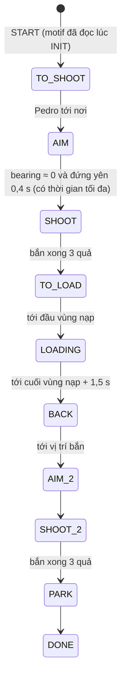

## 5.2 Những điểm đáng học trong code

**1. Hai "cỗ máy" chạy song song, cập nhật mỗi vòng lặp.** `follower.update()` và `shooter.update()` luôn được gọi
**trước** `switch`. Máy trạng thái chính chỉ ra lệnh ("đi đường này", "bắn 3 quả") rồi chờ `isBusy()` báo xong. Nhờ vậy
flywheel tăng tốc **trong lúc** robot đang chạy: telemetry cho thấy flywheel đã đủ 1945 RPM từ giây 0,6, còn robot tới
vị trí bắn ở giây 2,5.

```java
public void start() {
    follower.setPose(P.START);
    follower.follow(toShoot);
    shooter.setTargetRpm(table.get(55));           // quay sẵn với RPM dự đoán cho vị trí bắn
}
public void loop() {
    follower.update();
    shooter.update();
    switch (state) { ... }
}
```

**2. Ngắm bằng camera nhưng giữ vị trí bằng Pedro.** Pedro dùng radian, chiều ngược kim đồng hồ là dương. `bearing`
dương cũng nghĩa là "quay trái". Vì vậy hướng mới chỉ là `hướng hiện tại + bearing`:

```java
SimTagDetection goal = camera.getDetection(SimAprilTagCamera.BLUE_GOAL_ID);
if (goal != null) {
    shooter.setTargetRpm(table.get(goal.ftcPose.range));          // RPM theo khoảng cách thật
    if (Math.abs(goal.ftcPose.bearing) > 1.0 && timer.seconds() < 1.5) {
        Pose p = follower.pose();
        follower.hold(new Pose(p.x(), p.y(), p.heading() + Math.toRadians(goal.ftcPose.bearing)));
        return false;
    }
}
return timer.seconds() > 0.4;                                      // đứng yên một chút cho robot ổn định
```

Đoạn code có hai "lối thoát hiểm". **Không thấy thẻ** (camera hỏng, thẻ ra khỏi khung hình) thì sau 0,4 s robot vẫn
bắn theo hướng của odometry. **Thấy thẻ nhưng mãi chưa ngắm xong** thì quá 1,5 s cũng bắn. Robot không bao giờ đứng
chờ mãi: **mọi vòng chờ trong Autonomous đều cần thời gian tối đa**. Telemetry cho thấy bước ngắm đổi hướng robot từ
136,2° (hướng tới tâm miệng goal) sang ≈ 134° (hướng tới thẻ 20): đúng 2° chênh lệch đã tính ở mục 3.2.

**3. Bắt "cạnh lên" của trạng thái.** Để ghi màu quả bóng **đúng lúc** nó được đẩy, code so sánh trạng thái bây giờ với
vòng lặp trước. Nó chỉ ghi khi `Shooter` **vừa** chuyển sang `PUSH`, không ghi mỗi vòng lặp trong lúc đang `PUSH`:

```java
if (shooter.getState() == Shooter.State.PUSH && lastShooterState != Shooter.State.PUSH) {
    shotColors.append(ColorUtil.artifactColor(ballColor, ballDistance));   // màu quả sắp bắn
}
lastShooterState = shooter.getState();
```

**4. Đổi tốc độ cho riêng một đoạn đường** bằng modifier của Pedro v3 (mục 2.4):

```java
loadCreep = Paths.line(LOAD_START, LOAD_END).constant(LOAD_START)
        .with(Constants.foresightConfig.maxPathSpeed.at(0.3));     // bò chậm qua vùng nạp
```

**5. Một bài học gỡ lỗi có thật.** Phiên bản đầu của trạng thái `LOADING` bắt đầu đếm 1,5 s **ngay khi bật intake**.
Kết quả: robot chỉ nạp được 2 bóng. Phần lớn thời gian chờ đã trôi qua lúc robot còn đang bò vào vùng nạp. Cách sửa:
**chỉ bắt đầu đếm khi đã tới nơi**.

```java
case LOADING:
    if (follower.isBusy()) timer.reset();                   // đếm giờ khi đã vào hẳn vùng nạp
    else if (timer.seconds() > 1.5) { ... }                 // ~0,4 s / quả => chờ dư cho 3 quả
```

## 5.3 Kết quả

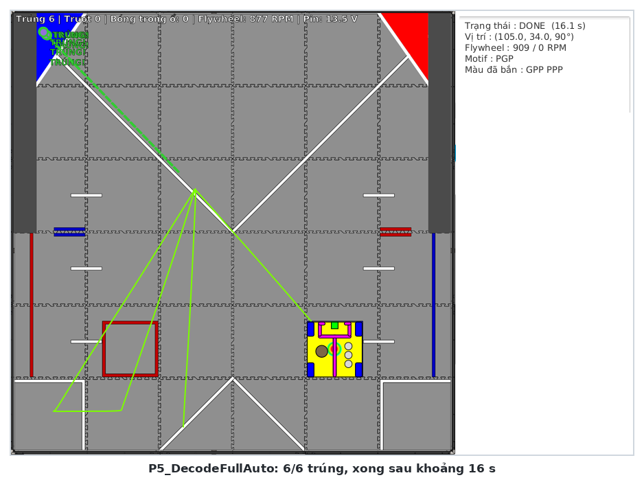

Một lần chạy điển hình: **6/6 TRÚNG**, xong toàn bộ (kể cả về BASE) sau khoảng **16 giây**, còn dư nhiều so với
30 giây của giai đoạn Autonomous. Khi xong, dòng *Trạng thái* trên telemetry hiện `DONE` kèm thời điểm xong (đồng hồ
dừng lại), để bạn đọc được tổng thời gian.

| Giai đoạn | Thời điểm (≈) |
|---|---|
| Tới vị trí bắn, flywheel đã đủ tốc | 0 → 2,5 s |
| Ngắm + bắn 3 quả | 2,5 → 4,0 s |
| Tới vùng nạp | 4,0 → 6,3 s |
| Nạp 3 bóng (bò chậm + chờ 1,5 s) | 6,3 → 9,6 s |
| Quay lại vị trí bắn | 9,6 → 12,4 s |
| Ngắm + bắn 3 quả | 12,4 → 14,0 s |
| Về BASE | 14,0 → 16,1 s |

So với ví dụ 2.3 (xong sau khoảng 12 s), bản này lâu hơn khoảng 4 s, chủ yếu vì phải vào tận vùng nạp ở góc dưới và
chờ nạp bóng. Ngắm + bắn chỉ mất khoảng 1,5 s mỗi lượt, gần bằng 1,5 s "bắn giả" của Phần 2.

Telemetry "Màu đã bắn" (ví dụ `GPP PPP`) cho biết thứ tự màu đã bắn. Thứ tự này phụ thuộc thứ tự bóng trong ổ, nên
chưa chắc khớp motif. Thử thách 3 dưới đây sẽ dùng thông tin này.

## 5.4 Thử thách mở rộng

Các thử thách dưới đây không có lời giải sẵn. Hãy dùng `SimTruth`, telemetry và CSV để tự kiểm chứng.

1. **Bản liên minh ĐỎ.** `new DecodePoses(true)` đã lấy đối xứng qua x = 72. Còn phải đổi: thẻ ngắm (`RED_GOAL_ID` = 24),
   vùng nạp sang góc dưới-phải (`PoseFactory.degrees().mirrorX(72)` cho `LOAD_START`, `LOAD_END`). Vì sân đối xứng nên
   bảng tra dùng lại được. Hãy kiểm chứng điều đó.
2. **Viết lại bằng lệnh Ivy** (ví dụ 2.4). Gợi ý: `sequential(...)` cho các bước, `parallel(...)` cho "vừa chạy vừa quay
   flywheel". Lệnh bắn là một lệnh tự viết, kết thúc khi `!shooter.isBusy()`.
3. **Điểm motif.** Viết hàm đếm xem chuỗi màu đã bắn khớp motif ở bao nhiêu vị trí (ví dụ motif `PGP`, đã bắn `PPG` →
   khớp 1/3). Sau đó suy nghĩ: cần thêm cơ cấu gì (hay thứ tự nạp nào) để luôn khớp 3/3?
4. **Đặt sai hướng xuất phát.** Đặt robot đúng chỗ (56, 9) nhưng nhìn **100°** thay vì 90° rồi chạy `P5_DecodeFullAuto`.
   Pedro vẫn tưởng robot nhìn 90° nên **cả đường đi bị xoay 10°** quanh điểm xuất phát: robot dừng ở khoảng (47, 87)
   thay vì (60, 86). Ở đó robot quá gần thẻ 20 nên thẻ lọt ra ngoài mép trên khung hình (ghi chú "Vì sao dừng ở 50 in"
   ở ví dụ 3.3). Bước `AIM` không thấy thẻ, chờ 0,4 s rồi bắn theo hướng sai của odometry. Trong lần chạy thử, **cả
   6 quả đều LỆCH TRÁI khoảng 19 in** (hình dưới). Ngược lại, đặt lệch **vị trí** 5 in mà đúng hướng, ví dụ (61, 9) nhìn
   90°, thì robot vẫn trúng 6/6: bước `AIM` thấy thẻ và tự sửa hướng ngắm, còn bảng tra tự chọn RPM theo khoảng cách
   thật.

   **Nhiệm vụ:** thêm bước định vị lại bằng AprilTag lúc INIT để robot trúng 6/6 dù đặt sai hướng. Gợi ý: dùng
   `TagLocalizer.robotPose` và lấy trung bình như ví dụ 3.4, **không** dùng `robotPoseWithHeading` vì chính hướng của
   odometry đang sai (ghi chú cuối ví dụ 3.4). Ý tưởng này đã được kiểm chứng: chạy `P3_Relocalize` với robot đặt ở
   (56, 9) nhìn 100°, vị trí ước lượng lúc INIT lệch vị trí thật 0,2 in và 0°, rồi robot tới (60, 86) chỉ lệch 0,2 in.

   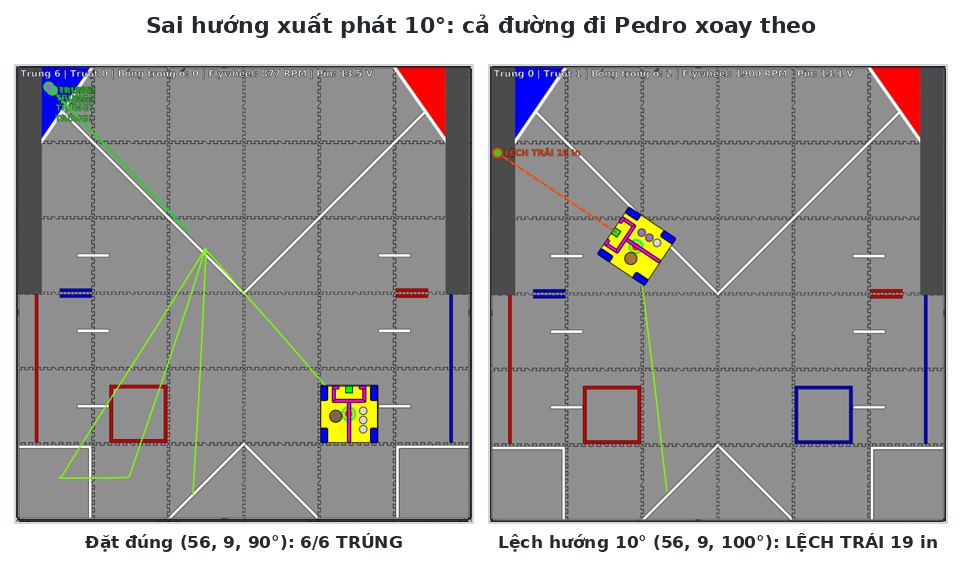

5. **Ba lượt bắn (9 quả) trong 30 giây.** Rút ngắn đường đi, tăng `maxPathSpeed`, cho intake chạy sớm hơn, bắn ngay khi
   tới nơi... Ghi lại thời gian từng giai đoạn để biết nên tối ưu chỗ nào trước. Bài 2.3 đã làm phần di chuyển cho
   3 lượt trong khoảng 19 s.
6. **(Nâng cao) Bắn khi đang chạy.** Bóng bay mất khoảng 0,5–0,8 s. Nếu robot đang chạy với vận tốc **v** thì bóng mang
   thêm vận tốc đó, nên phải ngắm vào điểm `goal − v × t_bay`. Hãy viết và thử trên đường `Paths.line(...).facingPoint(...)`
   của bài 2.4. Trong mô phỏng, cần sửa thêm phần chấm điểm của Shooter Bot để tính vận tốc robot. Bài này dành cho bạn nào
   muốn đọc code JavaFX của virtual_robot.

---

# Phụ lục

## A. Khắc phục sự cố thường gặp

**Cài đặt và chạy chương trình**

| Hiện tượng | Nguyên nhân hay gặp | Cách xử lý |
|---|---|---|
| Bấm ▶ báo lỗi `javafx...` hoặc không mở cửa sổ | JDK không có JavaFX | chọn **Liberica JDK 17 Full** ở *File → Project Structure → SDK* (mục 0.3) |
| Chữ tiếng Việt trong code bị lỗi font | file không được đọc bằng UTF-8 | *Settings → Editor → File Encodings* = UTF-8 cho cả Global và Project |
| Chữ tiếng Việt trong cửa sổ **Run** bị lỗi | console Windows không dùng UTF-8 | *Run → Edit Configurations → Main → VM options*: thêm `-Dfile.encoding=UTF-8 -Dstdout.encoding=UTF-8` |
| Không có **Shooter Bot** trong ô Configurations | chưa chép `ShooterBot.java` và `shooter_bot.fxml` vào `Controller` | chép cả hai thư mục `code/Controller` và `code/TeamCode` (mục 0.4) |
| OpMode không có trong danh sách | thiếu `@TeleOp`/`@Autonomous`, còn `@Disabled`, lớp không `public`, hoặc có lỗi biên dịch | sửa rồi chạy lại chương trình (dừng hẳn rồi ▶) |
| Lỗi `...not found in hardwareMap` | chọn sai cấu hình robot, hoặc gõ sai tên thiết bị | đọc danh sách thiết bị trong ô văn bản **trước khi INIT** (mục 0.5) |
| Tải virtual_robot bản mới từ GitHub | `Config.java` trở về mặc định | chép lại thư mục `code/` và sửa lại `Config.java` (mục 0.4) |

**Motor, cảm biến, Pedro Pathing (Phần 1–2)**

| Hiện tượng | Nguyên nhân hay gặp | Cách xử lý |
|---|---|---|
| Lỗi khi đổi sang `RUN_TO_POSITION` | chưa gọi `setTargetPosition` | luôn theo thứ tự: `setTargetPosition` → `setMode(RUN_TO_POSITION)` → `setPower` |
| Telemetry đứng yên trong `LinearOpMode` | quên `telemetry.update()` | gọi `telemetry.update()` sau mỗi nhóm `addData` (OpMode lặp thì SDK tự gọi) |
| Robot quay **ngược** chiều mong muốn | lẫn quy ước dấu giữa IMU, `MecanumDrive`, Pedro và AprilTag | xem bảng quy ước dấu ở mục B |
| Bánh xe không phản ứng với thanh trượt "Motor Error / Inertia" | MecDynamic Bot và Shooter Bot dùng mô hình vật lý riêng | đúng như thiết kế (mục 0.6). Thanh trượt chỉ tác động lên Programming Board, Mecanum Bot |
| Cảm biến khoảng cách luôn trả về 820 cm | ngoài tầm 5–100 cm, nhìn xiên quá 7°, hoặc trước mặt là vật không phải tường | quay robot vuông góc với tường; nhớ mô phỏng chỉ "thấy" tường sân |
| Không tìm được vạch trắng | ngưỡng cố định không hợp nền; cảm biến nằm ở tâm robot nên phải đi tới khi **tâm** robot qua vạch | hiệu chuẩn độ sáng nền lúc INIT như ví dụ 1.6 |
| Pedro chạy lệch cả đường | robot không đặt đúng chỗ START lúc INIT, hoặc quên `setPose` | đặt robot bằng chuột trước INIT. So "vị trí thật" trên telemetry (mục 0.7) |
| Cả đường đi Pedro bị **xoay**, bắn lệch hàng loạt | robot đặt **sai hướng** lúc INIT | click phải để xoay robot đúng hướng; hoặc định vị lại bằng thẻ lúc INIT (ví dụ 3.4, thử thách 4 ở Phần 5) |
| Pedro "lắc", không tới đích | dùng cấu hình khác MecDynamic Bot / Shooter Bot, hoặc quên gọi `follower.update()` mỗi vòng | hằng số Pedro chỉ đúng cho khung gầm MecDynamic (mục 2.6) |
| Lệnh Ivy của lần chạy trước vẫn chạy | `Scheduler` là `static` | gọi `Scheduler.reset()` ở đầu `init()` (ví dụ 2.4) |

**AprilTag và flywheel (Phần 3–5)**

| Hiện tượng | Nguyên nhân hay gặp | Cách xử lý |
|---|---|---|
| Camera không thấy thẻ | không quay về phía thẻ, đứng **gần hơn ~42 in** (thẻ goal ra khỏi khung hình dọc), xa hơn 160 in, hoặc nhìn quá xiên | xem hình ở mục 3.4. Lùi ra xa, quay lại. Tạm tắt nhiễu (`noiseEnabled = false`) để kiểm tra |
| Motif mỗi lần chạy một khác | cố ý: thẻ obelisk được chọn ngẫu nhiên như bốc thăm | đọc motif bằng code, không đoán |
| Servo đẩy nhưng bóng không bay | servo chưa giữ đủ 100 ms; ổ đã hết bóng | dùng lớp `Shooter`. Xem dòng trạng thái và cửa sổ Run |
| Toàn "LỆCH TRÁI/PHẢI" | chưa ngắm (`bearing` ≠ 0), đang hướng về goal kia, hoặc odometry sai hướng | giữ LB để tự ngắm (ví dụ 4.5); kiểm tra hướng xuất phát |
| "QUÁ YẾU" | flywheel chậm hơn khoảng 1800 RPM nên bóng không lên tới độ cao miệng goal. Hay gặp khi đẩy bóng lúc bánh chưa hồi tốc | dùng máy trạng thái của `Shooter`: chỉ đẩy khi đủ tốc (mục 4.4) |
| Đứng sát goal thì quả nào cũng "DÀI" | hood cố định 55°: phải đủ ~1800 RPM bóng mới lên tới miệng goal, mà tốc độ đó đã bay quá goal nếu đứng gần hơn khoảng 35–40 in | lùi ra xa (vị trí SHOOT cách goal ≈ 61 in) |
| Cùng RPM mà lúc trúng lúc trượt | điều khiển hở (phụ thuộc pin), hoặc bắn khi chưa đủ tốc | dùng `Shooter` (feedforward + P + bù pin) và chờ `atSpeed()` |
| Kết quả "giật cục" khi đổi bộ hệ số PIDF giữa chừng | tích phân cũ còn tồn | đổi hệ số lúc INIT, hoặc STOP rồi INIT lại |
| Bảng tra hết đúng sau khi sửa robot | dời camera hoặc đổi góc hood, bánh, motor | đo lại bảng tra (bài 4.4) |

## B. Tra cứu nhanh

**Phần cứng (FTC SDK, dùng được cả trong virtual_robot):**

```java
DcMotorEx m = hardwareMap.get(DcMotorEx.class, "ten");
m.setDirection(DcMotorSimple.Direction.REVERSE);
m.setZeroPowerBehavior(DcMotor.ZeroPowerBehavior.BRAKE);           // hoặc FLOAT
m.setMode(DcMotor.RunMode.STOP_AND_RESET_ENCODER);                 // rồi RUN_USING_ENCODER / RUN_WITHOUT_ENCODER
m.setPower(0.5);  m.setVelocity(1000);                             // tick/giây (RUN_USING_ENCODER)
m.setTargetPosition(1120);  m.setMode(DcMotor.RunMode.RUN_TO_POSITION);
int pos = m.getCurrentPosition();  double tps = m.getVelocity();
m.setPIDFCoefficients(DcMotor.RunMode.RUN_USING_ENCODER, new PIDFCoefficients(p, i, d, f));   // P, I, D, F

Servo s = hardwareMap.get(Servo.class, "servo");  s.setPosition(0.5);          // 0..1
DigitalChannel touch = hardwareMap.get(DigitalChannel.class, "touch_sensor");  boolean pressed = !touch.getState();
AnalogInput pot = hardwareMap.get(AnalogInput.class, "pot");  pot.getVoltage();
DistanceSensor ds = hardwareMap.get(DistanceSensor.class, "front_distance");  ds.getDistance(DistanceUnit.INCH);
ColorSensor cs = hardwareMap.get(ColorSensor.class, "color_sensor");  cs.red(); cs.green(); cs.blue();
IMU imu = hardwareMap.get(IMU.class, "imu");  imu.getRobotYawPitchRollAngles().getYaw(AngleUnit.DEGREES);
GoBildaPinpointDriver odo = hardwareMap.get(GoBildaPinpointDriver.class, "pinpoint");  odo.update();  odo.getPosition();
VoltageSensor v = hardwareMap.voltageSensor.iterator().next();  v.getVoltage();
ElapsedTime timer = new ElapsedTime();  timer.reset();  timer.seconds();  timer.milliseconds();
```

**Quy ước dấu (nguồn gốc của rất nhiều lỗi "robot quay ngược"):**

| Đại lượng | Dương nghĩa là |
|---|---|
| `gamepad1.left_stick_y` | cần kéo **xuống** (đẩy lên là âm, nên code viết `-gamepad1.left_stick_y`) |
| yaw của IMU, heading của Pinpoint và Pedro | quay **ngược** chiều kim đồng hồ (sang trái) |
| `rotate` trong `MecanumDrive.drive(forward, right, rotate)` (theo sách) | quay **thuận** chiều kim đồng hồ (sang phải) |
| `DrivePowers(tiến, ngang, quay)` của Pedro | tiến, sang **trái**, quay **ngược** chiều kim đồng hồ |
| `ftcPose.x` của AprilTag | thẻ nằm bên **phải** tâm ảnh |
| `ftcPose.bearing` | thẻ lệch **trái**: phải quay **trái** để ngắm |
| `ftcPose.yaw` | thẻ xoay **ngược** chiều kim đồng hồ so với mặt camera; khi đã ngắm (`bearing ≈ 0`): robot đứng lệch về phía **tay trái** của nó so với pháp tuyến của thẻ |
| `ftcPose.z`, `ftcPose.elevation` | thẻ **cao hơn** camera |

Hệ quả hay gặp: ngắm bằng `MecanumDrive` thì viết `rotate = −K × bearing` (ví dụ 3.3, ví dụ 4.5); ngắm bằng Pedro thì
hướng mới là `heading + bearing` (Phần 5), vì Pedro và `bearing` cùng lấy "quay trái" là dương.

**Lớp kèm theo tài liệu:**

| Lớp | Hàm chính | Dùng ở |
|---|---|---|
| `MecanumDrive` | `init(hw)`, `drive(forward, right, rotate)` (rotate > 0 = quay phải), `driveFieldRelative(...)`, `stop()`, `averageForwardTicks()`, `resetEncoders()` | Phần 1, 3, 4 |
| `Pidf` | `new Pidf(kP, kI, kD, kF)`, `calculate(target, measured)`, `reset()` (có chống tích phân "phình", sách ch. 24.5.3) | bài 2.5 |
| `DecodePoses` | `START`, `SHOOT`, `INTAKE_START`, `INTAKE_END`, `BASE`, `GOAL`, `aimHeadingDeg(x, y)`; `new DecodePoses(true)` = liên minh ĐỎ | Phần 2, 3, 5 |
| `SimAprilTagCamera` | `getDetections()`, `getDetection(id)`, `noiseEnabled`, `getObeliskIdForTesting()` | Phần 3, 4, 5 |
| `TagLocalizer` | `robotPose(d, camF, camL, camYaw)`, `robotPoseWithHeading(d, headingDeg, ...)` → `{x, y, headingDeg}` | Phần 3 |
| `Shooter` | `init(hw)`, `setTargetRpm(rpm)`, `shoot(n)`, `update()` (mỗi vòng), `atSpeed()`, `isBusy()`, `getRpm()`, `stop()` | Phần 4, 5 |
| `InterpLUT` / `ShooterTable` | `add(x, y)`, `get(x)` (nội suy, kẹp 2 đầu) / `ShooterTable.create()` | Phần 4, 5 |
| `ShooterPhysics` | `requiredRpm(distanceIn)` | bài 4.6 |
| `ColorUtil` | `artifactColor(color, distance)` → `'P'` / `'G'` / `'-'` (theo sắc độ, mục 1.1.4) | Phần 4, 5 |
| `MovingAverage` | `new MovingAverage(n)`, `add(v)` → trung bình n giá trị gần nhất | khi cần lọc nhiễu cảm biến |
| `SimTruth` | `poseInchesDegrees()`, `pedroPose()`: vị trí thật, **chỉ có trong mô phỏng** | mọi phần |

Pedro Pathing v3: xem bảng tra nhanh và bảng đối chiếu với Pedro 2.x ở mục 2.5.

## C. Từ mô phỏng sang robot thật: danh sách kiểm tra

1. **Camera:** thay `SimAprilTagCamera` bằng `AprilTagProcessor` + `VisionPortal` (lớp `TagCamera` ở mục 3.3). Khai báo
   đúng vị trí lắp camera trong `setCameraPose`. Nhớ kiểm tra `detection.metadata != null`.
2. **Bỏ `SimTruth`:** robot thật không biết "vị trí thật". Hãy `setPose` bằng vị trí START đo sẵn trên sân, hoặc định vị
   bằng AprilTag (ví dụ 3.4).
3. **Đo lại mọi hằng số:** tick/vòng và đường kính bánh, `KP`, `MIN_POWER`, dung sai của từng vòng điều khiển ở Phần 1;
   `kV`/`kS`/`kP` của flywheel (bài 4.2), PIDF (mục 4.3), bảng tra RPM (bài 4.4), vị trí lắp camera. Với Pedro, chạy các
   OpMode tinh chỉnh (`ForwardVelocity`, `ForwardBraking`...) và điền hằng số vào `Constants`.
4. **Chiều và hướng:** chiều quay từng motor (`REVERSE`), hướng lắp Hub cho IMU (`RevHubOrientationOnRobot`), chiều
   encoder và vị trí lắp hai bánh odometry của Pinpoint. Lần đầu luôn thử với công suất thấp, robot kê cao không chạm sàn.
5. **Cảm biến thật nhiễu hơn:** lọc bằng trung bình nhiều lần đo, kiểm tra giá trị ngoài tầm, hiệu chuẩn cảm biến màu
   theo ánh sáng của nơi thi đấu, chỉnh phơi sáng camera để ảnh không nhòe (mục 3.3).
6. **An toàn:** mọi vòng chờ đều có thời gian tối đa, giới hạn công suất bằng `Range.clip`, xử lý `null` khi mất thẻ,
   có nút dừng khẩn trong TeleOp.
7. **Tên thiết bị:** đặt tên trong cấu hình trên Driver Station **giống hệt** tên trong code (`"front_left_motor"`,
   `"imu"`, `"pinpoint"`, `"shooter_motor"`, `"feeder_servo"`...).
8. **Pin:** thử bắn với pin đầy và pin yếu. Feedforward có bù điện áp phải cho cùng kết quả.
9. **Mùa giải mới:** cập nhật tọa độ xuất phát và mục tiêu, ID và vị trí thẻ AprilTag
   (`AprilTagGameDatabase.getCurrentGameTagLibrary()` của SDK mới), rồi đo lại bảng tra nếu robot vẫn phải bắn. Phương
   pháp (điều khiển P, Pedro, feedforward + P, máy trạng thái, bảng tra, định vị bằng thẻ) giữ nguyên.

## D. Nguồn tham khảo

- Alan G. Smith, *Learn Java for FTC*, bản PDF ngày 11/05/2026: ch. 6–12, 16, 20, 21, 23, 24, 25.
- virtual_robot (Beta8397): https://github.com/Beta8397/virtual_robot. Trong repo có `Detailed Installation
  Instructions.pdf` (cài đặt) và `Using with PedroPathing and RoadRunner.pdf`. Tài liệu thứ hai khuyên dùng cấu hình
  MecDynamic Bot cho Pedro Pathing và cho biết repo kèm sẵn Pedro Pathing 3 (có Ivy) và Road Runner 1.0.1.
- Pedro Pathing: https://github.com/Pedro-Pathing/PedroPathing
- FTC Docs, AprilTag (giới thiệu, *Understanding AprilTag Detection Values*, *AprilTag Localization*):
  https://ftc-docs.firstinspires.org/en/latest/apriltag/vision_portal/apriltag_intro/apriltag-intro.html
- FTC Docs (lưu trữ), *AprilTag Challenges in DECODE*:
  https://ftc-docs.firstinspires.org/projects/ftcdocs-archive/en/latest/decode_apriltag/decode-apriltag.html
- FTC Docs, *Changing PIDF Coefficients*:
  https://ftc-docs.firstinspires.org/programming_resources/shared/pidf_coefficients/pidf-coefficients.html
- REV Robotics, công thức khởi đầu cho PIDF vận tốc: https://docs.revrobotics.com/first-global/fgc-pid
- Limelight, lập trình FTC (MegaTag2): https://docs.limelightvision.io/docs/docs-limelight/apis/ftc-programming
- FTC SDK: https://github.com/FIRST-Tech-Challenge/FtcRobotController. Các OpMode mẫu `ConceptAprilTag`,
  `ConceptAprilTagLocalization`, `ConceptAprilTagOptimizeExposure`, `RobotAutoDriveToAprilTagOmni`.
